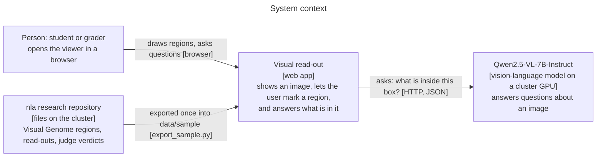
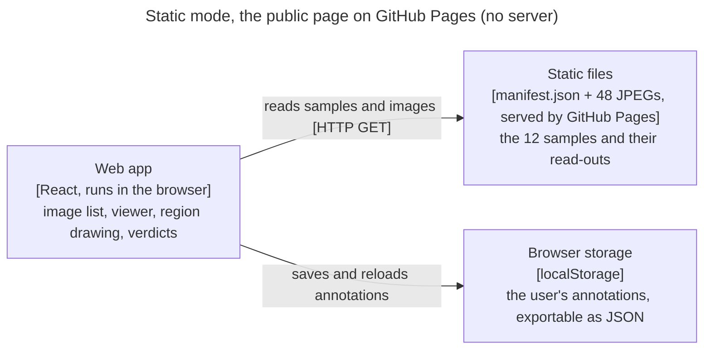
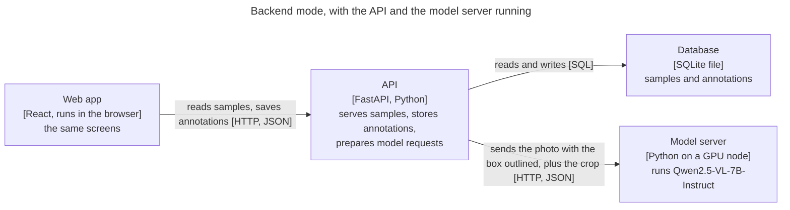
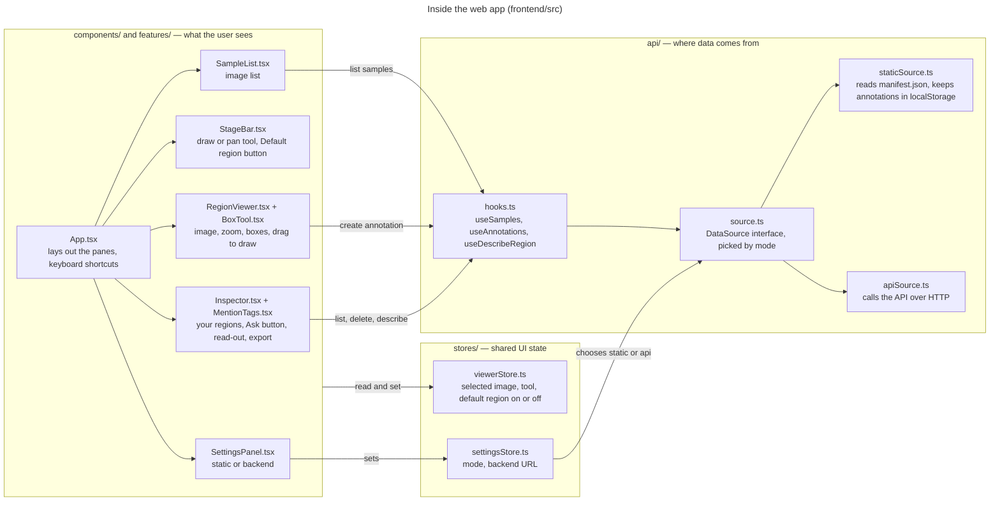
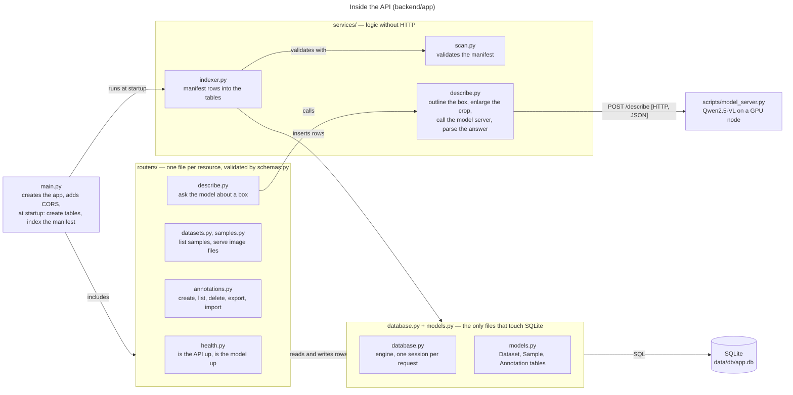
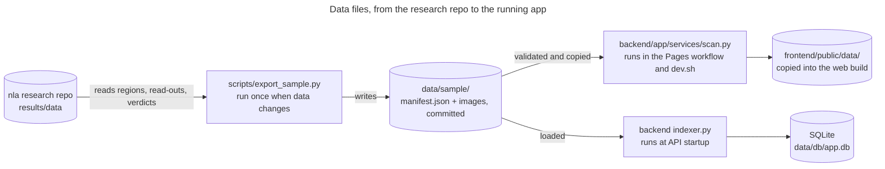
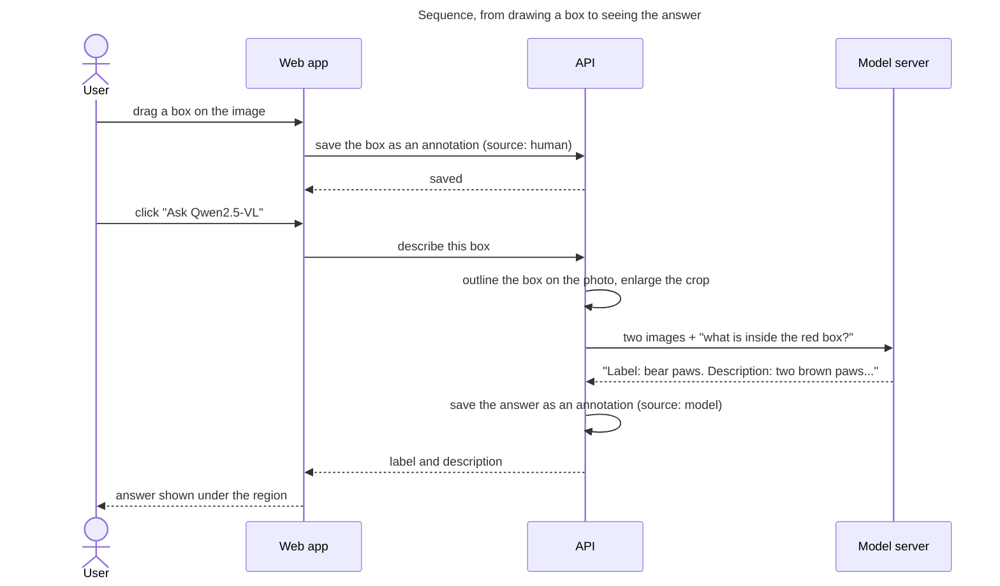
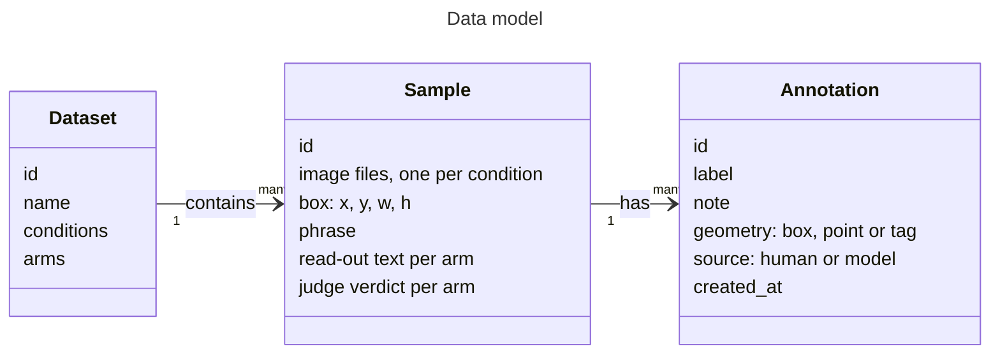
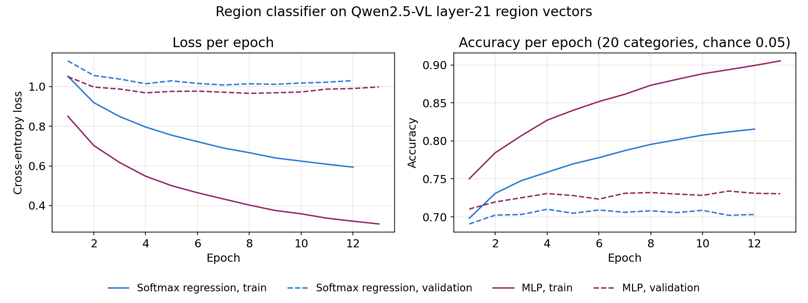

# Visual read-out

A web viewer for one kind of research data: a photo, a region of that photo, and what a vision-language model says about that region.

Live: **https://nkn002.github.io/visual-readout/** · DS7400 Deep Learning, Homeworks 1 and 2 · Author: Khai-Nguyen Nguyen

## The goal

A user opens an image, draws a region, and asks Qwen2.5-VL what is in it. A **Default region** button reveals the region the research dataset defined for that image and the text a verbalizer produced for it. Users can record their own verdicts and save everything. HW1 delivered that viewer. HW2 adds a trained neural network: **Predict** classifies a drawn region into one of 20 object classes from Qwen2.5-VL's internal activation for that region.

The research behind the data maps Qwen2.5-VL region activations into a frozen text verbalizer through a small trained connector. The viewer is the tool for looking at those regions and read-outs one at a time.

**Data type:** images plus boxes plus text. A sample is one Visual Genome region: an image, a box `[x, y, w, h]`, the phrase describing it, the verbalizer's read-out, and a judge's verdict. The committed sample has 12 regions.

## What you can do

| Feature | Where in the code |
|---|---|
| Browse the 12 images with thumbnails and arrow keys | `frontend/src/components/SampleList.tsx` |
| Zoom and pan the image, **Fit view** to undo | `frontend/src/features/viewer/RegionViewer.tsx` |
| **Annotation:** drag to draw a labelled region; rename it any time by clicking its label; delete one or clear all; export and import as JSON | `frontend/src/features/annotate/BoxTool.tsx`, `Inspector.tsx` |
| **Ask Qwen2.5-VL** what a drawn region contains | `backend/app/services/describe.py`, `scripts/model_server.py` |
| **Activation heatmap** of a drawn region: its tokens at the read-out layer (hidden state 21, output of layer 20) mean-pooled into one vector, as the research connector does, projected onto 64 principal components and shown as an 8 × 8 heatmap in a panel under the image | `scripts/model_server.py`, `backend/app/routers/activations.py`, `frontend/src/features/viewer/ActivationPanel.tsx` |
| **Default region:** reveal the dataset's box, its phrase, and the frozen verbalizer's read-out with the judge's verdict | `StageBar.tsx`, `Inspector.tsx` |
| Give your own names-it / misses-it verdict on that read-out | `frontend/src/features/annotate/MentionTags.tsx` |
| **HW2, Predict:** a trained MLP classifies a drawn region into 20 object classes and shows the top 5 with probabilities | `training/`, `backend/app/routers/predict.py`, `Inspector.tsx` |
| **HW2, model card:** the **Model** button shows the loss and accuracy curves, train/val/test scores against two baselines, and per-class recall | `frontend/src/components/ModelCard.tsx`, `backend/model/metrics.json` |
| **Backend:** annotations persist in SQLite through a FastAPI service | `backend/app/` |
| Two data modes behind one interface: static (GitHub Pages) or backend | `frontend/src/api/` |
| Deploy to GitHub Pages on every push | `.github/workflows/pages.yml` |

Implemented annotation: **yes**. Implemented backend/database: **yes** (SQLite via SQLModel; tables are created at startup, migrations are a follow-up). Model in the loop: **yes**, Qwen2.5-VL-7B-Instruct on a cluster GPU, prompted directly.

## Run it

Static mode, what the live page does, no server:

```bash
python backend/app/services/scan.py --data data/sample --out frontend/public/data   # stage the sample
cd frontend && npm ci && npm run dev                                                # http://localhost:5173
```

Backend mode, annotations persist and the model can be asked:

```bash
cd backend && python3 -m venv .venv
.venv/bin/pip install torch numpy --index-url https://download.pytorch.org/whl/cpu   # CPU torch for the HW2 classifier
.venv/bin/pip install -e ".[dev]"
.venv/bin/uvicorn app.main:app --reload            # http://localhost:8000, docs at /docs
```

In the app open **Settings** (the pill in the top bar), choose **Backend**, and check the connection. In local dev the Vite proxy forwards `/api` to port 8000, so the URL can stay empty. From the public page use `http://localhost:8000`; Chrome asks once for permission to reach localhost.

Both at once, with the right URLs inside a UVA Open OnDemand VS Code session: `scripts/dev.sh`.

The model, on the UVA cluster (needs a GPU):

```bash
sbatch scripts/model_server.sbatch        # Qwen2.5-VL-7B-Instruct on an RTX 3090, about 90 s to load
tail -f data/db/model_server.<jobid>.log  # "serving http://<node>:8100" when ready
```

The server writes its address to `data/db/model_server.url`; the backend reads that file on every request, so nothing restarts. Without it, the Ask button answers with a clear "not running" message.

Docker, both services with hot reload: `docker compose up`, then open http://localhost:5173.

Tests: `cd backend && .venv/bin/python -m pytest` (13 tests, including a prediction through the trained model; indexing, endpoints, annotation round trip, import, manifest validation, the model call against a stand-in server).

## The repository, top down

The user can do seven things in this app. For each one, this section gives the story in a sentence, then the path through the files, then what changes in static mode.

Four words used below:

- **Router**: a backend file that owns one URL and answers requests to it (`backend/app/routers/`).
- **Service**: a backend file that does real work with no HTTP of its own (`backend/app/services/`).
- **Data source**: the one frontend file that talks to the outside, `frontend/src/api/apiSource.ts`. It sends JSON to the backend.
- **Static mode**: the public page on GitHub Pages, where there is no backend. `frontend/src/api/staticSource.ts` stands in for the data source: it reads `data/manifest.json` and keeps annotations in the browser.

Paths are written frontend → backend → frontend. Frontend files are under `frontend/src/`, backend files under `backend/app/`.

### 1. Browse the images

The user picks a thumbnail and sees the image, with zoom and pan.

`SampleList.tsx` asks for the list → `apiSource.ts` sends `GET /api/datasets/cf/samples` → `routers/datasets.py` reads the Sample rows from SQLite and returns them → `SampleList.tsx` shows the thumbnails, `RegionViewer.tsx` shows the chosen image. Each image itself comes from `GET /api/samples/{id}/file`, answered by `routers/samples.py`.

The rows come from `data/sample/manifest.json`; `services/indexer.py` loads them into SQLite when the backend starts.

Static mode: `staticSource.ts` reads `manifest.json` directly and shows the bundled images.

### 2. Draw a region

The user drags a box on the image, and it is saved with a label.

`StageBar.tsx` selects the box tool → `BoxTool.tsx` (inside `RegionViewer.tsx`) turns the drag into a box → `apiSource.ts` sends `POST /api/samples/{id}/annotations` with the box and label → `routers/annotations.py` saves an Annotation row with `source = "human"` and returns it → `Inspector.tsx` lists the region, `RegionViewer.tsx` draws it. Renaming a region (click its label) uses `PATCH /api/annotations/{id}`, and delete uses `DELETE /api/annotations/{id}`, both on the same router.

Static mode: the box is saved in the browser instead.

### 3. Ask Qwen2.5-VL what a region is

The user clicks **Ask Qwen2.5-VL** under a region. The backend crops the box, sends it to the model, and shows the model's answer under the region.

`Inspector.tsx` button → `apiSource.ts` sends `POST /api/samples/{id}/describe` with the box → `routers/describe.py` → `services/describe.py` outlines the box in red on the photo and enlarges the crop → `scripts/model_server.py` (Qwen2.5-VL-7B on a GPU node) runs the model and returns "Label: … Description: …" → `services/describe.py` parses it → `routers/describe.py` saves it as an Annotation with `source = "model"` and returns label and description → `Inspector.tsx` shows the answer under the region, `RegionViewer.tsx` draws the model's box in purple.

If the model server is not running, the router answers 503 and the message appears under the region.

Static mode: not available; the button says it needs the backend.

### 4. Show a region's activation heatmap

The user clicks **Activation heatmap** under a drawn region. A panel opens under the image showing that region's activation vector as a heatmap.

`Inspector.tsx` button → `apiSource.ts` sends `POST /api/samples/{id}/activations` with the box → `routers/activations.py` (cached after the first call) → `services/activations.py` sends the image and the box to `scripts/model_server.py` → the model server runs one forward pass of Qwen2.5-VL with hidden states, takes hidden state 21 (the output of layer 20, the read-out layer), selects the tokens under the box with the research code's own rule (`mmav.vgregions.box_to_tokens`, a token counts when the box covers half of it), and mean-pools them into one 3584-dimensional vector, exactly the connector's input. That is too much to read as a picture, so the server projects it onto 64 principal components fitted once on 20,000 of the research repo's own region vectors (`results/data/vgreg_V.npy`, cached in `data/db/pca64.npz`) → `ActivationPanel.tsx` draws the 64 scores as an 8 × 8 grid, blue for negative and red for positive with the colour range at the 99th percentile of the magnitudes, and lists the full vector's norm and its eight largest dimensions; hovering a cell shows the component's score and how much variance it explains. `RegionViewer.tsx` outlines the pooled tokens on the image.

Static mode: not available; the button says it needs the backend.

### 5. Reveal the default region and its read-out

The user clicks **Default region**. The dataset's own box appears on the image, with its phrase and the frozen verbalizer's read-out.

No request is sent. The box, phrase, read-out, and judge verdict arrived with the sample in action 1. `StageBar.tsx` flips a switch in `viewerStore.ts` → `RegionViewer.tsx` draws the box in orange, `Inspector.tsx` shows the text. Changing image turns it off.

Static mode: identical.

### 6. Give a verdict on the read-out

The user clicks **names it** or **misses it** under the read-out.

`MentionTags.tsx` (inside `Inspector.tsx`) → same path as action 2, saving an Annotation with a `tag` geometry. A new click replaces the earlier verdict.

Static mode: saved in the browser.

### 7. Export and import annotations

The user downloads their annotations as a JSON file, or loads one.

`Inspector.tsx` → `apiSource.ts` sends `GET /api/annotations` (export) or `POST /api/annotations/import` (import) → `routers/annotations.py` returns all rows, or inserts the new ones and skips ids it already has. Ids are made in the browser, so a file exported in static mode imports cleanly.

Static mode: reads or writes the browser's copy.

### 8. Switch between static and backend mode

The user opens Settings, picks a mode, and can test the connection.

`SettingsPanel.tsx` writes the mode to `settingsStore.ts`; every later call goes to `apiSource.ts` or `staticSource.ts` accordingly. **Check connection** → `GET /api/health` → `routers/health.py` reports whether the API is up and whether the model server answers → the result is shown in the panel. `Header.tsx` shows the current mode.

### 9. Predict what a region shows (HW2)

The user clicks **Predict** under a drawn region. The trained MLP shows its five most likely object classes with probabilities.

`Inspector.tsx` button → `apiSource.ts` sends `POST /api/samples/{id}/predict` with the box → `routers/predict.py` → the model server pools the tokens under the box at hidden state 21 → `services/classifier.py` runs the MLP from `backend/model/mlp.pt` → the top 5 classes return → `TopClasses.tsx` draws them as bars under the region. The **Model** button opens `ModelCard.tsx`, which reads `metrics.json` and shows the curves and test scores.

Static mode: the default region's prediction and the model card work; predicting a drawn region needs the backend.

### Files behind every action

- Frontend: `main.tsx` starts React. `App.tsx` lays out the panes and handles keyboard shortcuts. `api/hooks.ts` wraps every data call so the screen refreshes after a save. `api/source.ts` picks `apiSource.ts` or `staticSource.ts`. `stores/` holds the selected image, the tool, and the mode. `types/api.ts` holds the shapes of samples and annotations. `index.css` is all styling.
- Backend: `main.py` creates the app, allows the frontend's origins, includes the routers, and at startup creates the tables and runs the indexer. `config.py` reads `.env`. `schemas.py` checks every request and shapes every response. `models.py` defines the tables Dataset, Sample, Annotation. `database.py` gives each request one SQLite session. `tests/` runs the whole service against the sample data, with the model server replaced by a stand-in.

### Where the data comes from and how it runs

- `data/sample/`: `manifest.json` (the 12 samples: boxes, phrases, read-outs, verdicts) and `images/`. Built once by `scripts/export_sample.py` from the research repository. `data/raw/` and `data/db/` are ignored by git.
- `training/` holds the HW2 network and its pipeline: `prepare_data.py` builds the labelled split, `model.py` defines the MLP, `train.py` trains and evaluates it, `predict_defaults.py` precomputes the demo predictions, and `train.sbatch` runs training on a GPU.
- `scripts/dev.sh` starts frontend and backend and prints the URLs. `scripts/model_server.sbatch` runs `scripts/model_server.py` on a GPU as a Slurm job. `compose.yml` runs frontend and backend in Docker.
- `.github/workflows/pages.yml` deploys the frontend to `nkn002.github.io/visual-readout` on every push to `main`; `test.yml` runs the tests. `docs/DESIGN.md` records why it is built this way.

## How the components interact

Diagrams at four levels of zoom, following the C4 model: who uses the system, what runs where in each mode, which files inside each part call which, how one request travels, and what the data looks like. **Key:** a box is one running part, with its technology in brackets and its job underneath. An arrow is a one-way call, labelled with what it does and how.

### 1. Context: who talks to what



### 2. Containers: what runs where, in each mode

The app runs in two modes. The screens are identical; only where the data comes from and where annotations go changes.





### 3. Components: how the files inside the web app interact

Read left to right: what the user sees, the UI state it shares, and the data layer that hides where data comes from. `types/api.ts` (not drawn) defines the shapes every file below uses.



### 4. Components: how the files inside the API interact

Requests enter through `routers/`, logic lives in `services/`, and only `database.py` and `models.py` touch SQLite. Not drawn: `config.py` hands settings from `.env` to `main.py`, `database.py`, and `services/describe.py`; `schemas.py` defines the request and response shapes every router validates with.



### 5. Build and run: how the scripts move the data files



### 6. One request: asking the model about a drawn region



### 7. Data: what is stored

The same three shapes appear in `manifest.json`, in the SQLite tables, and in the TypeScript types.



## HW2: the region classifier

### What it predicts and why this model

**The classifier names the object in a region from Qwen2.5-VL's activation alone.** Its input is the vector the research connector reads: Qwen2.5-VL-7B's hidden state 21 (the output of layer 20), mean-pooled over the image tokens under the box, 3,584 numbers. Its output is one of 20 object classes. This tests whether the activation the verbalizer reads holds the object's identity, which is the question the research asks.

**A one-hidden-layer MLP is the smallest network the homework allows.** The architecture is 3584 → 512 → ReLU → dropout 0.5 → 20, with 1,845,780 parameters. The inputs are standardized with the training mean and standard deviation, which the checkpoint stores. Softmax regression, the same code with no hidden layer, is the shallow baseline.

### Data

- **The inputs come from the research repo's stored region vectors.** The repo holds 200,000 Visual Genome region vectors (`results/data/vgreg_V.npy`) and their phrases (`vgreg_meta.jsonl`). They were extracted with the same prompt, layer, token rule and pooling the app uses. The app's vector for the same box matches the stored one at cosine 0.995 to 0.998 on four checked regions.
- **Each label comes from the head noun of the region's phrase.** The head noun of each phrase (`mmav.site.head_noun`) maps to 20 classes through an explicit list in `training/prepare_data.py`. Plural stems are merged ("trees" and "tree" become tree). The people words (man, woman, boy, girl, people and others) are merged into person, and non-objects such as "part" are dropped. Each class is capped at 1,500 regions so "person" does not dominate.
- **The split is by image, so no photo has regions in two sets.** It is 80/10/10 with seed 0: 20,766 train, 2,555 validation and 2,488 test regions. The 12 demo images are excluded from all three.

### Training

`training/train.py` writes the loop out step by step:

1. `MLP.init_weights` initializes the parameters with He init and zero biases.
2. The forward pass computes the logits.
3. Cross-entropy gives the loss.
4. `loss.backward()` backpropagates the gradients.
5. Adam updates the parameters.
6. The loop repeats over mini-batches of 256.

Training stops when validation loss has not improved for 5 epochs, and the weights from the lowest-loss epoch are kept. Both models get the same tuning budget, learning rate {3e-4, 1e-3} by weight decay {1e-4, 1e-3}, and the MLP also tries width {256, 512, 1024} and dropout {0.2, 0.5}. Selection uses validation accuracy only; the test set is scored once, for the two selected models.



### Results

| Model | Train acc | Val acc | Test acc | Test top-5 | Test macro-F1 |
|---|---|---|---|---|---|
| Majority class (cloud) | 6.1% | 4.7% | 4.2% | – | – |
| Softmax regression | 90.8% | 81.4% | 81.7% | 97.5% | 82.3% |
| **MLP (served)** | 95.0% | 83.5% | **82.6%** | 97.7% | 83.2% |

**Both models read the object from the activation at about 82% test accuracy, against 4% for the majority class.**

**The MLP has lower test error than softmax regression, but this test set does not separate them.** The MLP's error is 17.4% against 18.3% for softmax regression, a gap of +0.9 points. The 95% paired-bootstrap interval is -0.1 to +2.0 points (n = 2,488), so the interval includes zero.

**The object's identity is close to linearly readable from the region activation, so a hidden layer adds little.** The MLP fits the training set to 95.0% and overfits quickly, which dropout and early stopping limit. This is a hypothesis about why the gap is small, not a tested claim.

One disclosure about the test set: before the final grid, a smoke test (`--quick`) printed test accuracy for one configuration of each model, 79.9% for softmax regression and 79.3% for the MLP. Neither configuration is the one selected, and nothing was tuned on those numbers.

### How a prediction reaches the screen

The user draws a box and clicks **Predict**. `Inspector.tsx` asks `apiSource.ts` to send `POST /api/samples/{id}/predict` with the box. `routers/predict.py` asks the model server (`scripts/model_server.py`, Qwen2.5-VL on a GPU) for the region's pooled vector at hidden state 21. `services/classifier.py` loads `backend/model/mlp.pt` once and runs the MLP on CPU. The browser receives the top 5 classes with their softmax probabilities and draws them as bars under the region.

The 12 default regions already have vectors in the research data, so `training/predict_defaults.py` precomputes their predictions. The static GitHub Pages site shows those predictions and the model card without any server. Predicting a newly drawn region needs the backend and the GPU job.

### Reproduce

```bash
/home/rbc5xp/.conda/envs/nnedit/bin/python training/prepare_data.py   # data/raw/regions20.npz (git-ignored, 195 MB)
sbatch training/train.sbatch                                           # or: python training/train.py   (about 1 min on one GPU)
backend/.venv/bin/python training/predict_defaults.py                  # data/sample/predictions.json
```

The trained weights (`backend/model/mlp.pt`, `baseline.pt`), the class list and `metrics.json` are committed. The backend needs CPU torch: `pip install torch --index-url https://download.pytorch.org/whl/cpu`.

### Use of AI

Claude (Anthropic), an AI coding agent, wrote the code in `training/` and the HW2 changes to the backend and frontend at the author's direction. The author chose the task, the data, the label set and the setup. The MLP and training loop are standard PyTorch, and no outside model implementation was copied.

## Why React and not a plain HTML page

An academic page is a document: fixed content, no state. This page has state: the selected image, the active tool, boxes being dragged, annotations that change, two data sources. React splits that into components that re-render when state changes, and TypeScript checks that the data shapes match the backend. The compiled `dist/` is still a plain static site, the same kind of thing as a paper page; only the source is organised as an app.

## Libraries

Frontend: React 19, Vite 8, TypeScript, TanStack Query (server data), Zustand (UI state), react-zoom-pan-pinch (zoom and pan). Backend: FastAPI, SQLModel (SQLAlchemy + Pydantic), SQLite, pydantic-settings, Pillow, httpx, PyTorch (CPU, for the classifier), pytest. Training: PyTorch, NumPy, matplotlib. Model server: PyTorch, Transformers, Qwen2.5-VL-7B-Instruct.

## Working on it with an agent

A new data type is a new component registered in `frontend/src/features/viewer/registry.ts` that takes `ViewerProps`. A new annotation shape is a new `Geometry` variant in `frontend/src/types/api.ts`, drawn in `RegionViewer.tsx`. A new endpoint is a router in `backend/app/routers/` included in `main.py`, with a test in `backend/tests/`. A trained model for a later homework loads in `scripts/model_server.py` or in the backend's `lifespan`, and its outputs are stored as annotations with `source = "model"`.

## Roadmap

HW3: detection-style outputs, with the classifier's predictions drawn as `source = "model"` boxes next to human ones. HW4: region-level edits and read-out comparison at scale.
