# Visual read-out

A web viewer for one kind of research data: a photo, a region of that photo, and what a vision-language model says about that region.

Live: **https://nkn002.github.io/visual-readout/** · DS7400 Deep Learning, Homeworks 1, 2 and 3 · Author: Khai-Nguyen Nguyen

HW3 graders: the design challenge is in [HW3: attention pooling for the region probe](#hw3-attention-pooling-for-the-region-probe) and in [docs/hw3/report.pdf](docs/hw3/report.pdf).

## The goal

A user opens an image, draws a region, and asks Qwen2.5-VL what is in it. A **Default region** button reveals the region the research dataset defined for that image and the text a verbalizer produced for it. Users can record their own verdicts and save everything. HW1 delivered that viewer. HW2 adds a trained neural network: **Predict** classifies a drawn region into one of 20 semantic categories (person, wild animal, vehicle, plant, food and so on) from Qwen2.5-VL's internal activation for that region.

The research behind the data maps Qwen2.5-VL region activations into a frozen text verbalizer through a small trained connector. The viewer is the tool for looking at those regions and read-outs one at a time.

**Data type:** images plus boxes plus text. A sample is one Visual Genome region: an image, a box `[x, y, w, h]`, the phrase describing it, the verbalizer's read-out, and a judge's verdict. The committed sample has 12 regions.

## What you can do

| Feature | Where in the code |
|---|---|
| Browse the 12 images with thumbnails and arrow keys | `frontend/src/components/SampleList.tsx` |
| Zoom and pan the image, **Fit view** to undo | `frontend/src/features/viewer/RegionViewer.tsx` |
| **Annotation:** drag to draw a labelled region; rename it any time by clicking its label; delete one or clear all; export and import as JSON | `frontend/src/features/annotate/BoxTool.tsx`, `Inspector.tsx` |
| **Ask Qwen2.5-VL** what a drawn region contains | `backend/app/services/describe.py`, `scripts/model_server.py` |
| **Activation heatmap** of a drawn region: its tokens at the read-out layer (hidden state 21, output of layer 20) mean-pooled into one vector, as the research connector does, projected onto 64 principal components and shown as an 8 × 8 heatmap in a panel under the image | `scripts/model_server.py`, `backend/app/routers/activations.py`, `frontend/src/features/viewer/ActivationPanel.tsx` |
| **Default region:** reveal the dataset's box, its phrase, and the frozen verbalizer's read-out with the judge's verdict | `StageBar.tsx`, `Inspector.tsx` |
| Give your own names-it / misses-it verdict on that read-out | `frontend/src/features/annotate/MentionTags.tsx` |
| **HW2, Predict:** a trained MLP classifies a drawn region into 20 semantic categories and shows the top 5 with probabilities | `training/`, `backend/app/routers/predict.py`, `Inspector.tsx` |
| **HW2 optional, interactive training:** the **Train** button picks learning rate, epochs, hidden layers and units, activation, dropout, weight decay, batch size and training-set size, then trains in the backend | `frontend/src/components/TrainPanel.tsx`, `backend/app/routers/train.py`, `backend/app/services/trainer.py` |
| **HW2 optional, training monitor:** the same panel draws train and validation loss and accuracy live, one point per epoch, then shows loss, accuracy, top-5 and macro-F1 on train, validation and test, plus predictions on random test regions; **Use this model for Predict** serves the new model until reset | `TrainPanel.tsx`, `LineChart.tsx` |
| **HW2, Visualize the probe:** for a drawn region, shows the input crop and its 3,584-number vector, each probe layer with the hidden units that fire, and the 20 output probabilities | `frontend/src/components/ProbeViewPanel.tsx`, `POST /api/samples/{id}/probe` |
| **HW2, model card:** the **Model** button shows the loss and accuracy curves, train/val/test scores against two baselines, and per-class recall | `frontend/src/components/ModelCard.tsx`, `backend/model/metrics.json` |
| **Backend:** annotations persist in SQLite through a FastAPI service | `backend/app/` |
| Two data modes behind one interface: static (GitHub Pages) or backend | `frontend/src/api/` |
| Deploy to GitHub Pages on every push | `.github/workflows/pages.yml` |

Implemented annotation: **yes**. Implemented backend/database: **yes** (SQLite via SQLModel; tables are created at startup, migrations are a follow-up). Model in the loop: **yes**, Qwen2.5-VL-7B-Instruct on a cluster GPU, prompted directly. HW2 optional challenges: **interactive training: yes; training monitor: yes** (backend mode).

## Run it

Static mode, what the live page does, no server:

```bash
python backend/app/services/scan.py --data data/sample --out frontend/public/data   # stage the sample
cd frontend && npm ci && npm run dev                                                # http://localhost:5173
```

Backend mode, annotations persist and the model can be asked:

```bash
cd backend && python3 -m venv .venv
.venv/bin/pip install torch numpy --index-url https://download.pytorch.org/whl/cpu   # CPU torch for the HW2 classifier
.venv/bin/pip install -e ".[dev]"
.venv/bin/uvicorn app.main:app --reload            # http://localhost:8000, docs at /docs
```

In the app open **Settings** (the pill in the top bar), choose **Backend**, and check the connection. In local dev the Vite proxy forwards `/api` to port 8000, so the URL can stay empty. From the public page use `http://localhost:8000`; Chrome asks once for permission to reach localhost.

Both at once, with the right URLs inside a UVA Open OnDemand VS Code session: `scripts/dev.sh`.

The model, on the UVA cluster (needs a GPU):

```bash
sbatch scripts/model_server.sbatch        # Qwen2.5-VL-7B-Instruct on an RTX 3090, about 90 s to load
tail -f data/db/model_server.<jobid>.log  # "serving http://<node>:8100" when ready
```

The server writes its address to `data/db/model_server.url`; the backend reads that file on every request, so nothing restarts. Without it, the Ask button answers with a clear "not running" message.

Docker, both services with hot reload: `docker compose up`, then open http://localhost:5173.

Tests: `cd backend && .venv/bin/python -m pytest` (14 tests, including a prediction through the trained model and a 2-epoch in-app training run; indexing, endpoints, annotation round trip, import, manifest validation, the model call against a stand-in server).

## The repository, top down

The user can do seven things in this app. For each one, this section gives the story in a sentence, then the path through the files, then what changes in static mode.

Four words used below:

- **Router**: a backend file that owns one URL and answers requests to it (`backend/app/routers/`).
- **Service**: a backend file that does real work with no HTTP of its own (`backend/app/services/`).
- **Data source**: the one frontend file that talks to the outside, `frontend/src/api/apiSource.ts`. It sends JSON to the backend.
- **Static mode**: the public page on GitHub Pages, where there is no backend. `frontend/src/api/staticSource.ts` stands in for the data source: it reads `data/manifest.json` and keeps annotations in the browser.

Paths are written frontend → backend → frontend. Frontend files are under `frontend/src/`, backend files under `backend/app/`.

### 1. Browse the images

The user picks a thumbnail and sees the image, with zoom and pan.

`SampleList.tsx` asks for the list → `apiSource.ts` sends `GET /api/datasets/cf/samples` → `routers/datasets.py` reads the Sample rows from SQLite and returns them → `SampleList.tsx` shows the thumbnails, `RegionViewer.tsx` shows the chosen image. Each image itself comes from `GET /api/samples/{id}/file`, answered by `routers/samples.py`.

The rows come from `data/sample/manifest.json`; `services/indexer.py` loads them into SQLite when the backend starts.

Static mode: `staticSource.ts` reads `manifest.json` directly and shows the bundled images.

### 2. Draw a region

The user drags a box on the image, and it is saved with a label.

`StageBar.tsx` selects the box tool → `BoxTool.tsx` (inside `RegionViewer.tsx`) turns the drag into a box → `apiSource.ts` sends `POST /api/samples/{id}/annotations` with the box and label → `routers/annotations.py` saves an Annotation row with `source = "human"` and returns it → `Inspector.tsx` lists the region, `RegionViewer.tsx` draws it. Renaming a region (click its label) uses `PATCH /api/annotations/{id}`, and delete uses `DELETE /api/annotations/{id}`, both on the same router.

Static mode: the box is saved in the browser instead.

### 3. Ask Qwen2.5-VL what a region is

The user clicks **Ask Qwen2.5-VL** under a region. The backend crops the box, sends it to the model, and shows the model's answer under the region.

`Inspector.tsx` button → `apiSource.ts` sends `POST /api/samples/{id}/describe` with the box → `routers/describe.py` → `services/describe.py` outlines the box in red on the photo and enlarges the crop → `scripts/model_server.py` (Qwen2.5-VL-7B on a GPU node) runs the model and returns "Label: … Description: …" → `services/describe.py` parses it → `routers/describe.py` saves it as an Annotation with `source = "model"` and returns label and description → `Inspector.tsx` shows the answer under the region, `RegionViewer.tsx` draws the model's box in purple.

If the model server is not running, the router answers 503 and the message appears under the region.

Static mode: not available; the button says it needs the backend.

### 4. Show a region's activation heatmap

The user clicks **Activation heatmap** under a drawn region. A panel opens under the image showing that region's activation vector as a heatmap.

`Inspector.tsx` button → `apiSource.ts` sends `POST /api/samples/{id}/activations` with the box → `routers/activations.py` (cached after the first call) → `services/activations.py` sends the image and the box to `scripts/model_server.py` → the model server runs one forward pass of Qwen2.5-VL with hidden states, takes hidden state 21 (the output of layer 20, the read-out layer), selects the tokens under the box with the research code's own rule (`mmav.vgregions.box_to_tokens`, a token counts when the box covers half of it), and mean-pools them into one 3584-dimensional vector, exactly the connector's input. That is too much to read as a picture, so the server projects it onto 64 principal components fitted once on 20,000 of the research repo's own region vectors (`results/data/vgreg_V.npy`, cached in `data/db/pca64.npz`) → `ActivationPanel.tsx` draws the 64 scores as an 8 × 8 grid, blue for negative and red for positive with the colour range at the 99th percentile of the magnitudes, and lists the full vector's norm and its eight largest dimensions; hovering a cell shows the component's score and how much variance it explains. `RegionViewer.tsx` outlines the pooled tokens on the image.

Static mode: not available; the button says it needs the backend.

### 5. Reveal the default region and its read-out

The user clicks **Default region**. The dataset's own box appears on the image, with its phrase and the frozen verbalizer's read-out.

No request is sent. The box, phrase, read-out, and judge verdict arrived with the sample in action 1. `StageBar.tsx` flips a switch in `viewerStore.ts` → `RegionViewer.tsx` draws the box in orange, `Inspector.tsx` shows the text. Changing image turns it off.

Static mode: identical.

### 6. Give a verdict on the read-out

The user clicks **names it** or **misses it** under the read-out.

`MentionTags.tsx` (inside `Inspector.tsx`) → same path as action 2, saving an Annotation with a `tag` geometry. A new click replaces the earlier verdict.

Static mode: saved in the browser.

### 7. Export and import annotations

The user downloads their annotations as a JSON file, or loads one.

`Inspector.tsx` → `apiSource.ts` sends `GET /api/annotations` (export) or `POST /api/annotations/import` (import) → `routers/annotations.py` returns all rows, or inserts the new ones and skips ids it already has. Ids are made in the browser, so a file exported in static mode imports cleanly.

Static mode: reads or writes the browser's copy.

### 8. Switch between static and backend mode

The user opens Settings, picks a mode, and can test the connection.

`SettingsPanel.tsx` writes the mode to `settingsStore.ts`; every later call goes to `apiSource.ts` or `staticSource.ts` accordingly. **Check connection** → `GET /api/health` → `routers/health.py` reports whether the API is up and whether the model server answers → the result is shown in the panel. `Header.tsx` shows the current mode.

### 9. Predict what a region shows (HW2)

The user clicks **Predict** under a drawn region. The trained MLP shows its five most likely categories with probabilities.

`Inspector.tsx` button → `apiSource.ts` sends `POST /api/samples/{id}/predict` with the box → `routers/predict.py` → the model server pools the tokens under the box at hidden state 21 → `services/classifier.py` runs the MLP from `backend/model/mlp.pt` → the top 5 classes return → `TopClasses.tsx` draws them as bars under the region. The **Model** button opens `ModelCard.tsx`, which reads `metrics.json` and shows the curves and test scores.

Static mode: the default region's prediction and the model card work; predicting a drawn region needs the backend.

### 10. Train a classifier and watch it learn (HW2 optional)

The user clicks **Train**, picks the settings and starts a run. The loss and accuracy curves grow one point per epoch.

`TrainPanel.tsx` → `apiSource.ts` sends `POST /api/train` with the settings → `routers/train.py` → `services/trainer.py` starts a thread that runs `train_one` from `training/train.py` on `data/raw/regions20.npz` → each finished epoch is appended to the run → the panel polls `GET /api/train/{id}` every second and redraws → when training ends, the panel shows train, validation and test scores and example predictions. **Use this model for Predict** calls `POST /api/train/{id}/use`, which makes `services/classifier.py` serve the new model until `POST /api/train/reset-model`.

Static mode: not available; training needs the backend.

### Files behind every action

- Frontend: `main.tsx` starts React. `App.tsx` lays out the panes and handles keyboard shortcuts. `api/hooks.ts` wraps every data call so the screen refreshes after a save. `api/source.ts` picks `apiSource.ts` or `staticSource.ts`. `stores/` holds the selected image, the tool, and the mode. `types/api.ts` holds the shapes of samples and annotations. `index.css` is all styling.
- Backend: `main.py` creates the app, allows the frontend's origins, includes the routers, and at startup creates the tables and runs the indexer. `config.py` reads `.env`. `schemas.py` checks every request and shapes every response. `models.py` defines the tables Dataset, Sample, Annotation. `database.py` gives each request one SQLite session. `tests/` runs the whole service against the sample data, with the model server replaced by a stand-in.

### Where the data comes from and how it runs

- `data/sample/`: `manifest.json` (the 12 samples: boxes, phrases, read-outs, verdicts) and `images/`. Built once by `scripts/export_sample.py` from the research repository. `data/raw/` and `data/db/` are ignored by git.
- `training/` holds the HW2 network and its pipeline: `prepare_data.py` builds the labelled split, `model.py` defines the MLP, `train.py` trains and evaluates it, `predict_defaults.py` precomputes the demo predictions, and `train.sbatch` runs training on a GPU.
- `scripts/dev.sh` starts frontend and backend and prints the URLs. `scripts/model_server.sbatch` runs `scripts/model_server.py` on a GPU as a Slurm job. `compose.yml` runs frontend and backend in Docker.
- `.github/workflows/pages.yml` deploys the frontend to `nkn002.github.io/visual-readout` on every push to `main`; `test.yml` runs the tests. `docs/DESIGN.md` records why it is built this way.

## How the components interact

Diagrams at four levels of zoom, following the C4 model: who uses the system, what runs where in each mode, which files inside each part call which, how one request travels, and what the data looks like. **Key:** a box is one running part, with its technology in brackets and its job underneath. An arrow is a one-way call, labelled with what it does and how.

### 1. Context: who talks to what

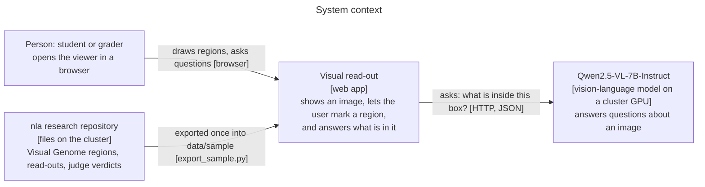

### 2. Containers: what runs where, in each mode

The app runs in two modes. The screens are identical; only where the data comes from and where annotations go changes.

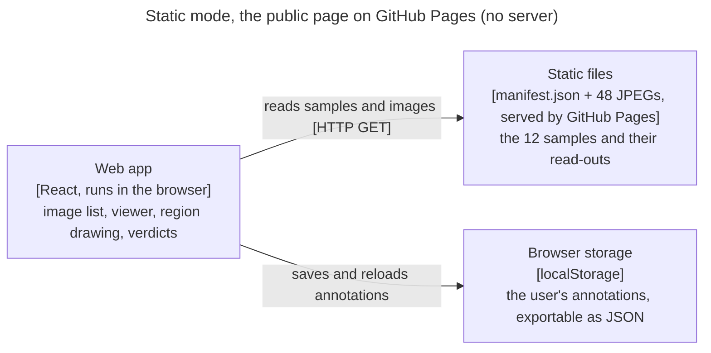

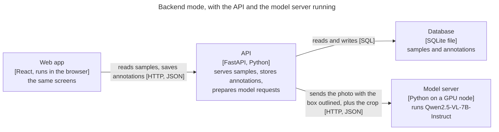

### 3. Components: how the files inside the web app interact

Read left to right: what the user sees, the UI state it shares, and the data layer that hides where data comes from. `types/api.ts` (not drawn) defines the shapes every file below uses.

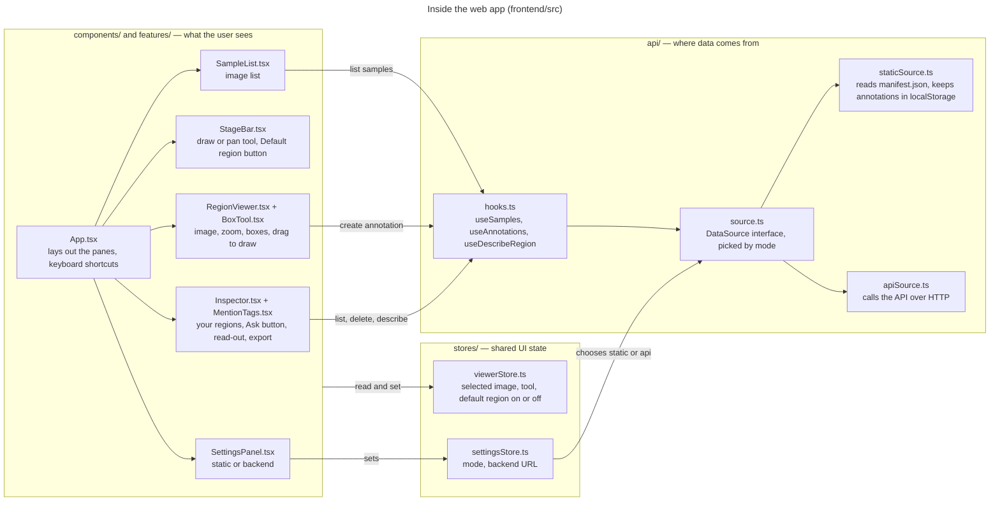

### 4. Components: how the files inside the API interact

Requests enter through `routers/`, logic lives in `services/`, and only `database.py` and `models.py` touch SQLite. Not drawn: `config.py` hands settings from `.env` to `main.py`, `database.py`, and `services/describe.py`; `schemas.py` defines the request and response shapes every router validates with.

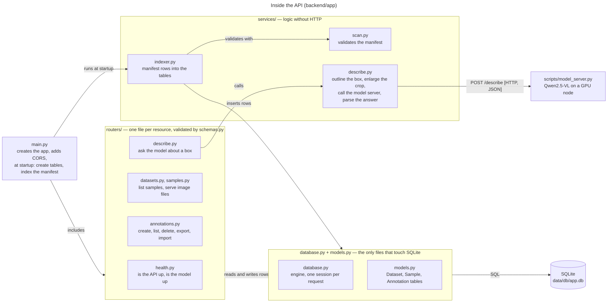

### 5. Build and run: how the scripts move the data files

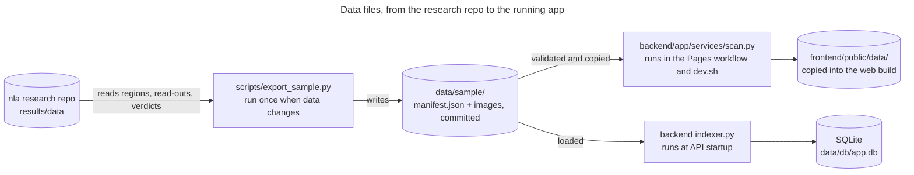

### 6. One request: asking the model about a drawn region

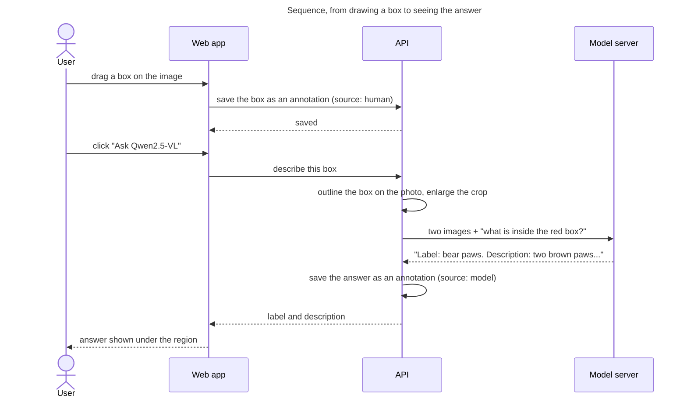

### 7. Data: what is stored

The same three shapes appear in `manifest.json`, in the SQLite tables, and in the TypeScript types.

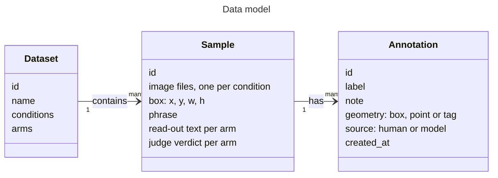

## HW2: the region classifier

### What it predicts and why this model

**The classifier names the kind of thing in a region from Qwen2.5-VL's activation alone.** Its input is the vector the research connector reads: Qwen2.5-VL-7B's hidden state 21 (the output of layer 20), mean-pooled over the image tokens under the box, 3,584 numbers. Its output is one of 20 semantic categories. This tests whether the activation the verbalizer reads holds what the region shows, which is the question the research asks.

**A one-hidden-layer MLP is the smallest network the homework allows.** The architecture is 3584 → 512 → ReLU → dropout 0.5 → 20, with 1,845,780 parameters. The inputs are standardized with the training mean and standard deviation, which the checkpoint stores. Softmax regression, the same code with no hidden layer, is the shallow baseline.

### Data

- **The inputs come from the research repo's stored region vectors.** The repo holds 200,000 Visual Genome region vectors (`results/data/vgreg_V.npy`) and their phrases (`vgreg_meta.jsonl`). They were extracted with the same prompt, layer, token rule and pooling the app uses. The app's vector for the same box matches the stored one at cosine 0.995 to 0.998 on four checked regions.
- **Each label is the region's head noun, grouped into one of 20 categories.** `training/prepare_data.py` takes the head noun of each phrase (`mmav.site.head_noun`) and maps it through an explicit word list: for example dog, cat and horse are domestic animal, tree, grass and flower are plant, and plate, bowl and fork are tableware. Plural forms are counted, and three phrases override the head noun: "license plate" is a vehicle, "hot dog" is food and "teddy bear" is a household object. Ambiguous or non-object nouns such as "part", "shadow", "trunk" and "light" are left out.
- **The 20 categories are** person, domestic animal, wild animal, head and face, limb, clothing and accessory, vehicle, sky and cloud, plant, ground and water, building, window and door, wall, floor and ceiling, street and road, food, tableware, furniture, household and electronics, sign and text, sports equipment.
- **Every category has the same size.** Each is capped at 2,500 regions, and all 20 have more than that, so the dataset holds 50,000 regions and chance accuracy is 5%.
- **The split is by image, so no photo has regions in two sets.** It is 80/10/10 with seed 0: 39,968 train, 5,075 validation and 4,957 test regions. The 12 demo images are excluded from all three.

### Training

`training/train.py` writes the loop out step by step:

1. `MLP.init_weights` initializes the parameters with He init and zero biases.
2. The forward pass computes the logits.
3. Cross-entropy gives the loss.
4. `loss.backward()` backpropagates the gradients.
5. Adam updates the parameters.
6. The loop repeats over mini-batches of 256.

Training stops when validation loss has not improved for 5 epochs, and the weights from the lowest-loss epoch are kept. Both models get the same tuning budget, learning rate {3e-4, 1e-3} by weight decay {1e-4, 1e-3}, and the MLP also tries width {256, 512, 1024} and dropout {0.2, 0.5}. Selection uses validation accuracy only; the test set is scored once, for the two selected models.

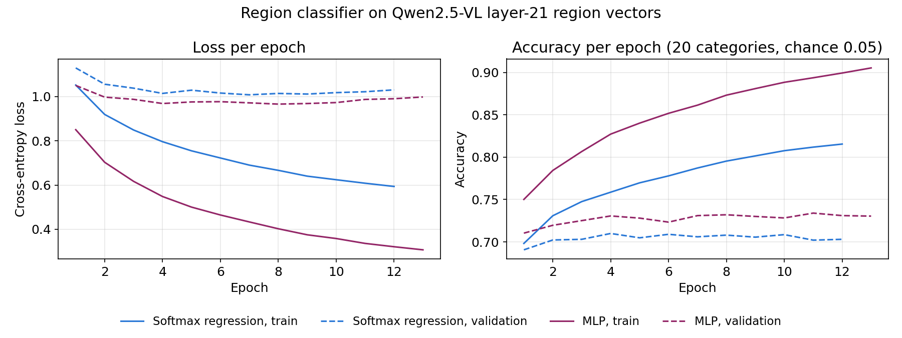

### Results

| Model | Train acc | Val acc | Test acc | Test top-5 | Test macro-F1 |
|---|---|---|---|---|---|
| Majority class (food) | 5.1% | 4.8% | 4.6% | – | – |
| Softmax regression | 78.7% | 70.6% | 71.9% | 96.0% | 71.8% |
| **MLP (served)** | 87.3% | 73.2% | **73.8%** | 96.6% | 73.6% |

**The MLP names the category of a held-out region 73.8% of the time, against 4.6% for the majority class.** Its top-5 accuracy is 96.6%.

**The MLP has lower test error than softmax regression, and the gap is outside noise.** The MLP's error is 26.2% against 28.1% for softmax regression, a gap of +1.9 points. The 95% paired-bootstrap interval is +1.0 to +2.7 points (n = 4,957).

**Each category joins several nouns, which may be why the hidden layer helps here.** An earlier version of this model predicted 20 single nouns. There the MLP led softmax regression by only +0.9 points (82.6% vs 81.7%), with a 95% interval of -0.1 to +2.0. A category such as "household and electronics" groups regions that do not sit in one linear direction, and a hidden layer can combine several directions. This is a hypothesis, not a tested claim.

**Both models overfit quickly.** The MLP fits the training set to 87.3% while validation stays near 73.2%. Dropout and early stopping limit the overfitting.

Two disclosures about the test set:

- **The earlier 20-noun version's test scores were seen before this label set was chosen.** The label set was replaced at the author's request because single nouns made odd classes. The 20 categories were fixed and approved before this model was trained, and this test set was scored once.
- **A smoke test of the first version printed test accuracy for configurations that were not selected.** Nothing was tuned on those numbers.

### How a prediction reaches the screen

The user draws a box and clicks **Predict**. `Inspector.tsx` asks `apiSource.ts` to send `POST /api/samples/{id}/predict` with the box. `routers/predict.py` asks the model server (`scripts/model_server.py`, Qwen2.5-VL on a GPU) for the region's pooled vector at hidden state 21. `services/classifier.py` loads `backend/model/mlp.pt` once and runs the MLP on CPU. The browser receives the top 5 categories with their softmax probabilities and draws them as bars under the region.

The 12 default regions already have vectors in the research data, so `training/predict_defaults.py` precomputes their predictions. The static GitHub Pages site shows those predictions and the model card without any server. Predicting a newly drawn region needs the backend and the GPU job.

### Train in the app (optional challenges)

**The Train panel runs the same `train_one` loop as `training/train.py`, in a background thread of the backend.** The loop reports each epoch through a callback, and the browser polls `GET /api/train/{id}` once a second to redraw the curves. **Stop** ends the run after the current epoch. The finished run reports loss, accuracy, top-5 and macro-F1 on train, validation and test, and shows eight random test regions with their true and predicted classes. **Use this model for Predict** swaps the served model in memory; `backend/model/mlp.pt` is never overwritten.

**Training runs on the backend's CPU, so the panel offers a smaller training set.** On the cluster's one-CPU VS Code node, one epoch takes about 2 s on 4,000 regions and about 18 s on all 39,968. In-app training needs `data/raw/regions20.npz` from `training/prepare_data.py`, which is git-ignored.

### Reproduce

```bash
/home/rbc5xp/.conda/envs/nnedit/bin/python training/prepare_data.py   # data/raw/regions20.npz (git-ignored, 195 MB)
sbatch training/train.sbatch                                           # or: python training/train.py   (about 1 min on one GPU)
backend/.venv/bin/python training/predict_defaults.py                  # data/sample/predictions.json
```

The trained weights (`backend/model/mlp.pt`, `baseline.pt`), the class list and `metrics.json` are committed. The backend needs CPU torch: `pip install torch --index-url https://download.pytorch.org/whl/cpu`.

### Use of AI

Claude (Anthropic), an AI coding agent, wrote the code in `training/` and the HW2 changes to the backend and frontend at the author's direction. The author chose the task, the data, the label set and the setup. The MLP and training loop are standard PyTorch, and no outside model implementation was copied.

## HW3: attention pooling for the region probe

The 2-page experiment report is [docs/hw3/report.pdf](docs/hw3/report.pdf). The hypothesis and predictions in [docs/hw3/hypothesis.md](docs/hw3/hypothesis.md) were committed at 15:02 on 2026-11-09 (commit `c03e240`), before token extraction finished and before any arm trained. The first result file is from 15:37.

### Task and dataset

**The HW3 probe solves the HW2 task on the HW2 data.** It names one of 20 semantic categories for a Visual Genome region from Qwen2.5-VL-7B's hidden state 21. The data are the same 50,000 regions, 2,500 per category, split by image into 39,968 train, 5,075 validation and 4,957 test regions (see the HW2 section above).

**HW3 needs every token under each box, not their mean.** `training/extract_tokens.py` re-runs Qwen2.5-VL with the research extraction's prompt, layer and token rule and keeps the tokens. It stores 1,549,854 tokens, 11.1 GB in float16, under `/scratch` and outside git. Each region's token mean matches its stored HW2 vector at median cosine 0.9999, and all 50,000 token counts match. A box covers 1 to 1,672 tokens, with a median of 9. 18.5% of regions cover a single token.

### Baseline: the HW2 probe

**The baseline averages the tokens under the box and classifies the mean.** Its MLP is 3584 → 512 → ReLU → dropout 0.5 → 20, the HW2 network, retrained here under the HW3 budget. Every token gets weight 1/L, whether it shows the object or the background.

### Proposed modification

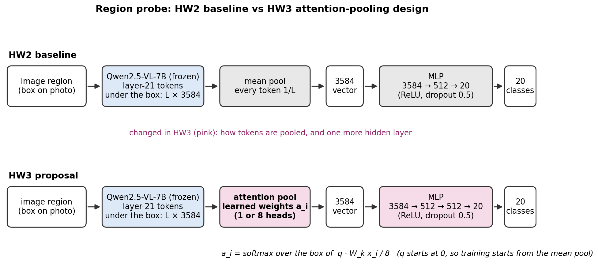

**The author's design replaces the mean with attention pooling and adds a second hidden layer** (`training/attention_probe.py`).

1. **A learned query scores every token under the box.** A linear map turns each standardized token into a 64-number key, and the score is the key's dot product with the query. A softmax over the box turns the scores into weights, and the pooled vector is the weighted sum of the tokens.
2. **The 8-head variant splits the vector into 8 slices of 448 numbers.** Each head has its own query and pools its own slice.
3. **The MLP gets a second hidden layer:** 3584 → 512 → ReLU → 512 → ReLU → 20, with dropout 0.5 after each hidden layer.
4. **The queries start at zero, so training starts from the exact HW2 mean pool.** Any departure from uniform weights has to be learned.

**The HW2 failure on person regions motivated the design.** Person recall was 50%, the lowest of the 20 categories. A person box often shows mostly a shirt, a face or an arm, so its mean vector mixes person with clothing, head and limb. Learned weights could favour the tokens that show the object. The second hidden layer adds non-linearity on the pooled vector.

**Six arms separate the two changes.** Pooling {mean, attention with 1 head, attention with 8 heads} crosses depth {1 hidden layer, 2 hidden layers}. The author's design is "attention 1 head, 2 hidden". The 8-head arms and the "mean, 2 hidden" arm are the ablations.

**Every arm gets the same budget.** Each arm uses Adam over learning rate {3e-4, 1e-3} × weight decay {1e-4, 1e-3}, with batch 256 and at most 50 epochs. Early stopping watches validation loss with patience 5. Each arm keeps its best setting on validation accuracy and reruns it with 3 seeds. The test set is scored only for the selected setting. Contrasts are paired bootstraps over test regions on seed-averaged correctness, so their intervals leave out training-seed variance. The 1-hidden arms all selected learning rate 3e-4 and weight decay 1e-3. At 2 hidden layers the mean arm selected weight decay 1e-4 and the attention arms 1e-3, so those contrasts also differ in weight decay.

### Run the experiments

```bash
PY=/home/rbc5xp/.conda/envs/nnedit/bin/python
$PY training/prepare_data.py                                          # data/raw/regions20.npz, as in HW2
$PY training/extract_tokens.py --out /scratch/rbc5xp/visual-readout   # tokens under every box: about 45 min on one A40
$PY training/train_hw3.py --tokens /scratch/rbc5xp/visual-readout     # six arms: about 5 min per three arms on one A40
#   split over two GPUs: --arms 0,2,5 on one, --arms 1,3,4 on the other, then --merge
$PY training/hw3_contrasts.py                                         # box-size and per-category intervals
$PY training/hw3_figures.py                                           # docs/hw3/*.png
```

`train_hw3.py --synthetic` runs the whole pipeline on random data as a smoke test. The training loop is written out step by step in `train_one`: forward pass, cross-entropy, `loss.backward()`, Adam step. The attention arms hold all tokens on the GPU and need about 13 GB of GPU memory. Results land in `results/hw3/` (committed): one JSON per arm, per-item test correctness, `results.json` and the 1-head model `best_attn1.pt`.

### Results

| Arm | Test acc (3 seeds) | Test macro-F1 | Train acc | Params | s / epoch |
|---|---|---|---|---|---|
| mean, 1 hidden (HW2 baseline) | 73.62 ± 0.38 | 73.46 | 82.41 | 1,845,780 | 0.09 |
| mean, 2 hidden | 74.10 ± 0.21 | 73.90 | 86.41 | 2,108,436 | 0.21 |
| attention 1 head, 1 hidden | 74.10 ± 0.15 | 74.01 | 83.73 | 2,075,220 | 0.77 |
| **attention 1 head, 2 hidden (proposed)** | 74.33 ± 0.08 | 74.16 | 83.90 | 2,337,876 | 0.69 |
| attention 8 heads, 1 hidden | 74.48 ± 0.17 | 74.42 | 88.08 | 3,681,300 | 1.09 |
| attention 8 heads, 2 hidden | **75.07 ± 0.25** | **74.92** | 83.10 | 3,943,956 | 1.23 |

| Contrast (test accuracy, points) | Gap | 95% CI |
|---|---|---|
| proposed design vs HW2 | +0.71 | [+0.05, +1.32] |
| depth only: mean, 2 hidden vs HW2 | +0.48 | [+0.01, +0.95] |
| 1-head attention vs mean, both 2 hidden | +0.24 | [−0.40, +0.80] |
| 8-head attention vs mean, 1 hidden | +0.86 | [+0.26, +1.43] |
| 8-head attention vs mean, 2 hidden | +0.97 | [+0.40, +1.52] |
| 8 heads vs 1 head, 2 hidden | +0.73 | [+0.24, +1.23] |
| best arm (8 heads, 2 hidden) vs HW2 | +1.45 | [+0.82, +2.06] |

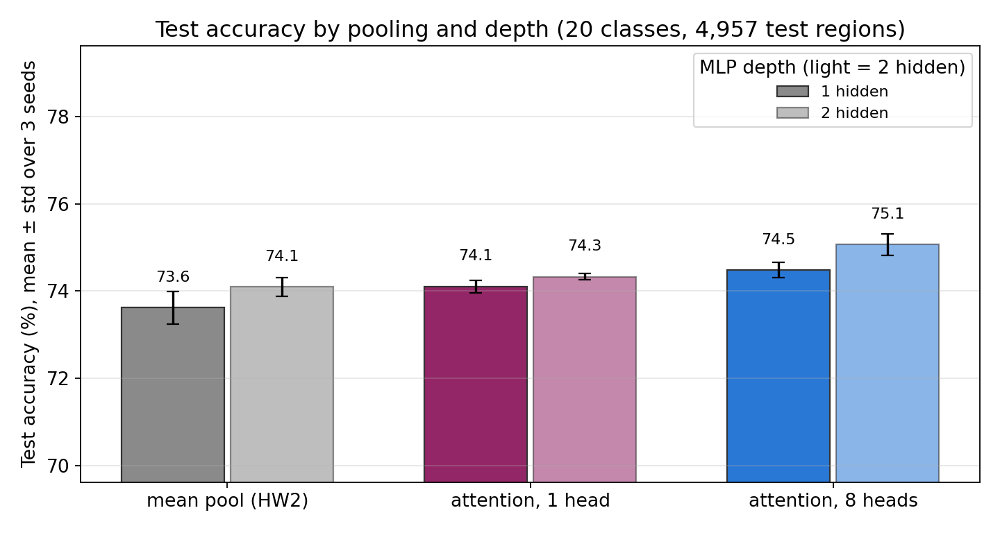

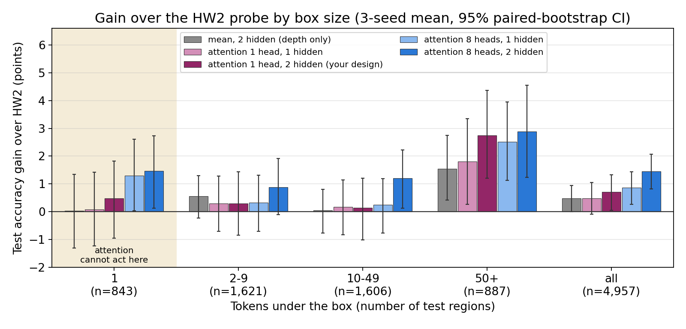

**The proposed design beats HW2 by 0.71 points, and its second hidden layer carries most of that gain.** The second hidden layer alone, on the mean pool, adds 0.48 points. One-head attention on top of the same depth adds 0.24 points, with an interval that includes zero.

**Eight heads beat the mean pool at both depths, and one head did not.** The 8-head gain is 0.86 points at one hidden layer and 0.97 at two. The best arm, 8 heads with 2 hidden layers, scores 75.07% against 73.62% for HW2.

**The 8-head arms also gained on one-token boxes, where attention cannot act.** On a one-token box the softmax gives weight 1, so attention returns the token itself and the MLP input equals HW2's. Yet 8 heads with 1 hidden layer gains 1.30 points there [+0.04, +2.61], at HW2's depth and with HW2's learning rate and weight decay. Its gain on all boxes with more than one token is 0.77 points [+0.17, +1.39], no larger. The lower bound of +0.04 is borderline, since it is one of about 30 box-size contrasts. Still, part of the 8-head gain appears where attention cannot act, so these data do not show that the whole gain comes from re-weighting tokens. Two hypotheses remain open. First, training the shared MLP on attention-pooled vectors may change what it learns for every input. Second, the intervals leave out training-seed variance, and HW2's own seeds span 73.09% to 73.90%.

**Gains concentrate on boxes of 50 or more tokens, but depth alone shows the same pattern.** There the attention arms gain 1.8 to 2.9 points, and the depth-only arm gains 1.54 [+0.41, +2.74]. The 10–49 token bin moves by 0.3 points or less, except for the 8-head, 2-hidden arm.

**One head at HW2's depth shows the pattern that predictions 1 and 2 named in advance.** It changes one-token boxes by +0.08 [−1.23, +1.42] and gains +1.80 [+0.26, +3.34] on boxes of 50 or more tokens. The depth-only arm shows a similar pattern by box size, and the per-bin contrast of 1-head attention against the mean at 2 hidden layers was not computed.

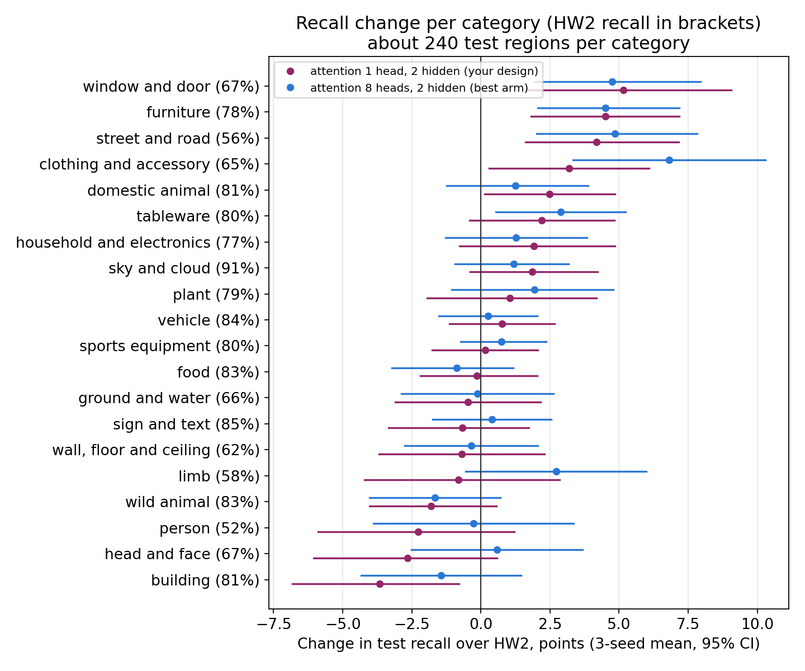

**Person recall, the motivation for the design, did not improve.** The proposed design changes it by −2.3 points [−5.9, +1.2], and the best arm by −0.3 [−3.9, +3.3]. Clothing gains in both 2-hidden attention arms: +3.2 [+0.3, +6.1] and +6.8 [+3.3, +10.3]. Window and door, street and road, and furniture gain in every attention arm, and the depth-only arm also gains on the first two. With 20 categories, about one category per arm would exclude zero by chance.

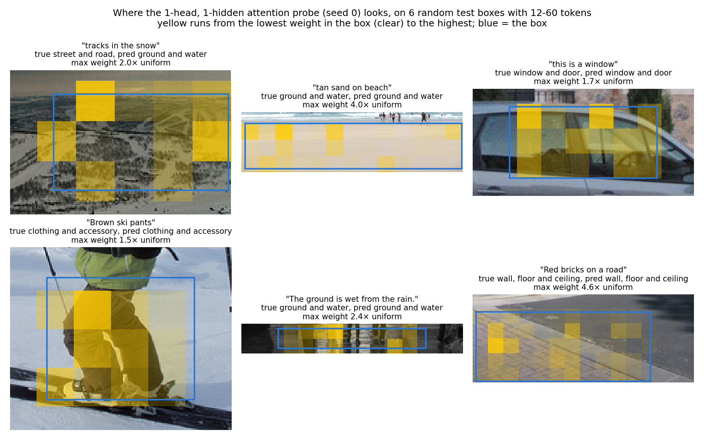

**Attention moved away from the mean pool but stayed diffuse.** On test boxes with more than one token, normalized attention entropy is 0.90 to 0.95, where 1 means uniform weights. The top token gets 2.0 to 2.9 times the uniform weight (medians). Validation entropy falls over training, for example from 0.99 to 0.86 for the 8-head, 2-hidden arm. The box's first token is the top token in 15–18% of boxes against 13–14% by chance. That rate sits only slightly above chance, so the strong position lock seen in the research project did not reappear.

**Attention costs 3 to 12 times more training time per epoch than the mean pool at the same depth.** An epoch takes 0.69 to 1.23 s against 0.09 s (1 hidden) and 0.21 s (2 hidden) for the mean pool. The attention arms use about 1.6 GB of GPU memory above the stored tokens against under 0.1 GB, and they need the 11.1 GB token store instead of one vector per region.

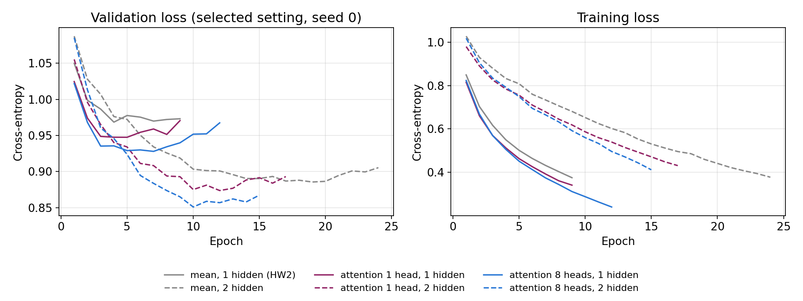

### What the experiment taught

- **The depth-only control changed the conclusion.** Without the "mean, 2 hidden" arm, the design's +0.71 would read as an attention effect.
- **The one-token boxes served as a built-in placebo.** They caught part of a gain appearing where attention cannot act, which a single accuracy number hides.
- **Eight heads gave the only attention effect whose interval excludes zero at both depths.** The placebo result above still leaves the cause of that effect open.
- **The attention weights did not fix the class they targeted.** Better pooling may need a different signal, such as supervision on which tokens show the object. This is an idea, not a tested result.

The app's **Predict** button still serves the HW2 probe. Serving the attention probe would need the model server to return every token under the box, and that change is not made.

### Use of AI

Claude (Anthropic), an AI coding agent, wrote `extract_tokens.py`, `attention_probe.py`, `train_hw3.py`, `hw3_contrasts.py` and the figure scripts. It also drafted the hypothesis document, the report and this section. The author chose the modification, attention pooling with a second hidden layer, the 1-head against 8-head ablation and the 2×2 control design, and approved the hypothesis before any result. The attention pool and training loop are plain PyTorch, and no outside implementation was copied.

## Why React and not a plain HTML page

An academic page is a document: fixed content, no state. This page has state: the selected image, the active tool, boxes being dragged, annotations that change, two data sources. React splits that into components that re-render when state changes, and TypeScript checks that the data shapes match the backend. The compiled `dist/` is still a plain static site, the same kind of thing as a paper page; only the source is organised as an app.

## Libraries

Frontend: React 19, Vite 8, TypeScript, TanStack Query (server data), Zustand (UI state), react-zoom-pan-pinch (zoom and pan). Backend: FastAPI, SQLModel (SQLAlchemy + Pydantic), SQLite, pydantic-settings, Pillow, httpx, PyTorch (CPU, for the classifier), pytest. Training: PyTorch, NumPy, matplotlib. Model server: PyTorch, Transformers, Qwen2.5-VL-7B-Instruct.

## Working on it with an agent

A new data type is a new component registered in `frontend/src/features/viewer/registry.ts` that takes `ViewerProps`. A new annotation shape is a new `Geometry` variant in `frontend/src/types/api.ts`, drawn in `RegionViewer.tsx`. A new endpoint is a router in `backend/app/routers/` included in `main.py`, with a test in `backend/tests/`. A trained model for a later homework loads in `scripts/model_server.py` or in the backend's `lifespan`, and its outputs are stored as annotations with `source = "model"`.

## Roadmap

HW3: detection-style outputs, with the classifier's predictions drawn as `source = "model"` boxes next to human ones. HW4: region-level edits and read-out comparison at scale.
