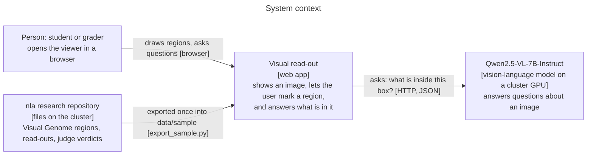
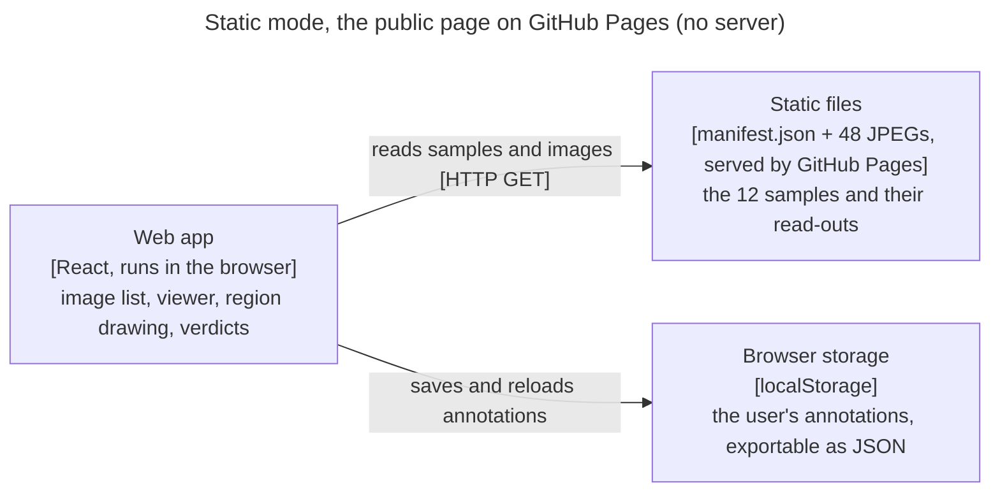
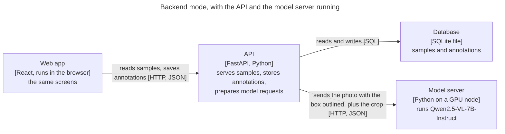
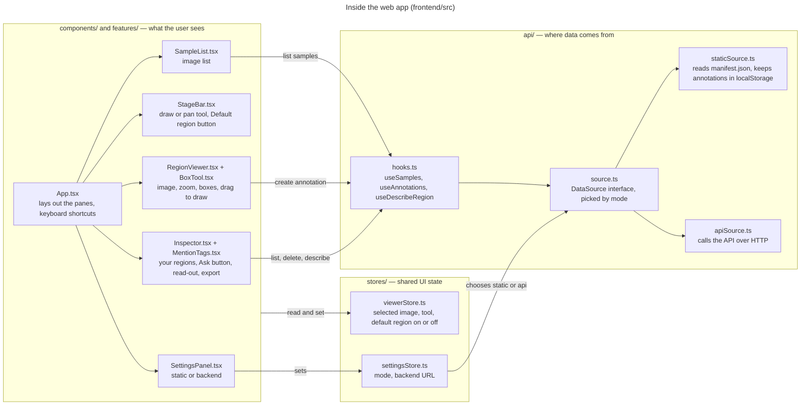
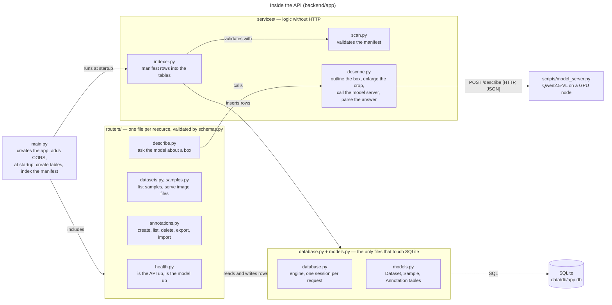
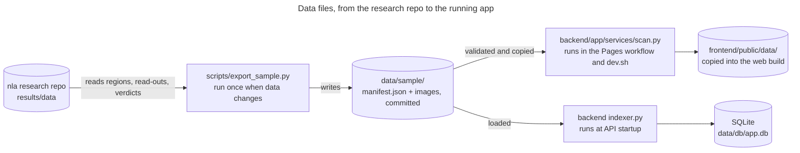
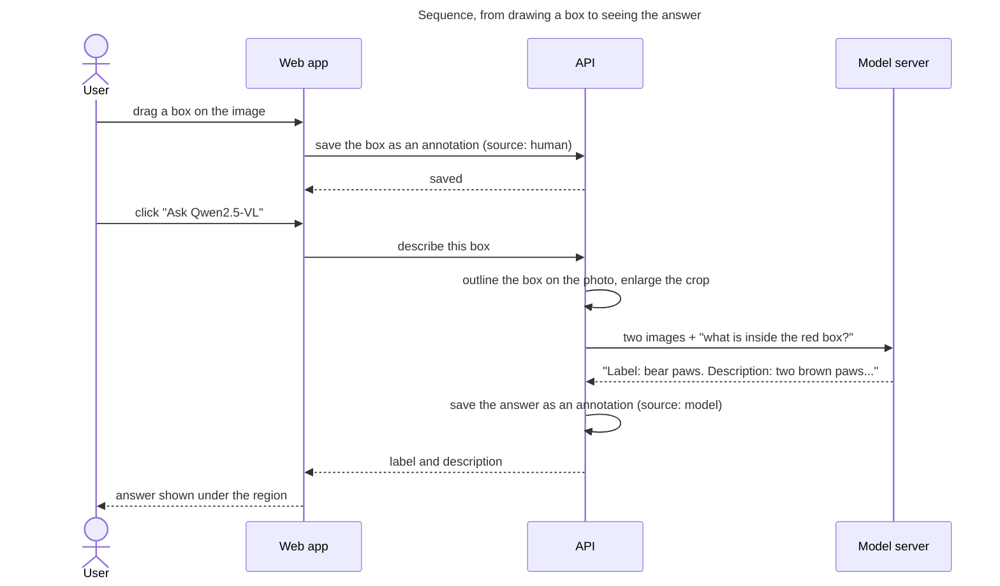
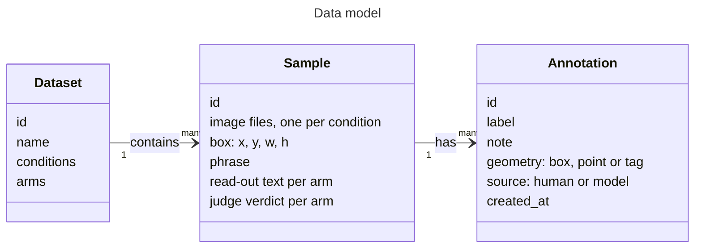

# Visual read-out

A web viewer for one kind of research data: a photo, a region of that photo, and what a vision-language model says about that region.

Live: **https://nkn002.github.io/visual-readout/** · DS7400 Deep Learning, Homework 1 · Author: Khai-Nguyen Nguyen

## The goal

A user opens an image, draws a region, and asks Qwen2.5-VL what is in it. A **Default region** button reveals the region the research dataset defined for that image and the text a verbalizer produced for it. Users can record their own verdicts and save everything. HW1 delivers that viewer; later homeworks add trained models on top of it.

The research behind the data maps Qwen2.5-VL region activations into a frozen text verbalizer through a small trained connector. The viewer is the tool for looking at those regions and read-outs one at a time.

**Data type:** images plus boxes plus text. A sample is one Visual Genome region: an image, a box `[x, y, w, h]`, the phrase describing it, the verbalizer's read-out, and a judge's verdict. The committed sample has 12 regions.

## What you can do

| Feature | Where in the code |
|---|---|
| Browse the 12 images with thumbnails and arrow keys | `frontend/src/components/SampleList.tsx` |
| Zoom and pan the image | `frontend/src/features/viewer/RegionViewer.tsx` |
| **Annotation:** drag to draw a labelled region; delete; export and import as JSON | `frontend/src/features/annotate/BoxTool.tsx`, `Inspector.tsx` |
| **Ask Qwen2.5-VL** what a drawn region contains | `backend/app/services/describe.py`, `scripts/model_server.py` |
| **Default region:** reveal the dataset's box, its phrase, and the frozen verbalizer's read-out with the judge's verdict | `StageBar.tsx`, `Inspector.tsx` |
| Give your own names-it / misses-it verdict on that read-out | `frontend/src/features/annotate/MentionTags.tsx` |
| **Backend:** annotations persist in SQLite through a FastAPI service | `backend/app/` |
| Two data modes behind one interface: static (GitHub Pages) or backend | `frontend/src/api/` |
| Deploy to GitHub Pages on every push | `.github/workflows/pages.yml` |

Implemented annotation: **yes**. Implemented backend/database: **yes** (SQLite via SQLModel; tables are created at startup, migrations are a follow-up). Model in the loop: **yes**, Qwen2.5-VL-7B-Instruct on a cluster GPU, prompted directly.

## Run it

Static mode, what the live page does, no server:

```bash
python backend/app/services/scan.py --data data/sample --out frontend/public/data   # stage the sample
cd frontend && npm ci && npm run dev                                                # http://localhost:5173
```

Backend mode, annotations persist and the model can be asked:

```bash
cd backend && python3 -m venv .venv && .venv/bin/pip install -e ".[dev]"
.venv/bin/uvicorn app.main:app --reload            # http://localhost:8000, docs at /docs
```

In the app open **Settings** (the pill in the top bar), choose **Backend**, and check the connection. In local dev the Vite proxy forwards `/api` to port 8000, so the URL can stay empty. From the public page use `http://localhost:8000`; Chrome asks once for permission to reach localhost.

Both at once, with the right URLs inside a UVA Open OnDemand VS Code session: `scripts/dev.sh`.

The model, on the UVA cluster (needs a GPU):

```bash
sbatch scripts/model_server.sbatch        # Qwen2.5-VL-7B-Instruct on an RTX 3090, about 90 s to load
tail -f data/db/model_server.<jobid>.log  # "serving http://<node>:8100" when ready
```

The server writes its address to `data/db/model_server.url`; the backend reads that file on every request, so nothing restarts. Without it, the Ask button answers with a clear "not running" message.

Docker, both services with hot reload: `docker compose up`, then open http://localhost:5173.

Tests: `cd backend && .venv/bin/python -m pytest` (11 tests: indexing, endpoints, annotation round trip, import, manifest validation, the model call against a stand-in server).

## The repository, top down

The user can do seven things in this app: browse the images, draw a region, ask Qwen2.5-VL what a region is, reveal the dataset's default region and its read-out, give a verdict on that read-out, export or import their annotations, and switch between static and backend mode. Each action below names the frontend files that handle it, the signal sent to the backend, the backend files that answer, and where the result lands.

Two files sit on every path. In the browser, `frontend/src/api/source.ts` decides whether a call goes to `staticSource.ts` (no server: reads `data/manifest.json`, keeps annotations in the browser; this is what GitHub Pages runs) or to `apiSource.ts` (sends JSON to the backend). On the server, `backend/app/main.py` receives every request and passes it to the router that owns the URL. "Backend mode" below means `apiSource.ts` is active.

### 1. Browse the images

`components/SampleList.tsx` shows one thumbnail per image; `App.tsx` keeps the selected one in `stores/viewerStore.ts`; `features/viewer/RegionViewer.tsx` shows it with zoom and pan.

To get the list, `SampleList.tsx` calls `useSamples` in `api/hooks.ts`. In backend mode `apiSource.ts` sends `GET /api/datasets/cf/samples`; `routers/datasets.py` reads the Sample rows through `database.py` and `models.py` (rows that `services/indexer.py` loaded from `data/sample/manifest.json` when `main.py` started) and returns them as JSON. Each `` then asks `GET /api/samples/{id}/file`, which `routers/samples.py` answers with the JPEG bytes. `hooks.ts` caches the list and `SampleList.tsx` renders it. In static mode `staticSource.ts` reads `manifest.json` itself and points the `` tags at the bundled files.

### 2. Draw a region

`components/StageBar.tsx` sets the tool in `viewerStore.ts`. With the box tool active, `features/annotate/BoxTool.tsx` (inside `RegionViewer.tsx`) turns a drag into a box in normalised image coordinates and hands it to `useCreateAnnotation` in `hooks.ts`, with the label typed in `components/Inspector.tsx`.

In backend mode `apiSource.ts` sends `POST /api/samples/{id}/annotations` with `{label, geometry}`; `routers/annotations.py` checks the body against `schemas.py`, inserts an `Annotation` row with `source = "human"` through `models.py`, and returns the stored row. `hooks.ts` then refreshes `useAnnotations`, so `Inspector.tsx` lists the new region and `RegionViewer.tsx` draws it. Deleting a region goes the same way with `DELETE /api/annotations/{id}`. In static mode `staticSource.ts` writes the row to `localStorage` instead.

### 3. Ask Qwen2.5-VL what a region is

Under each drawn region, `Inspector.tsx` has an **Ask Qwen2.5-VL** button. Clicking it calls `useDescribeRegion` in `hooks.ts` with that region's box.

`apiSource.ts` sends `POST /api/samples/{id}/describe` with `{geometry}`. `routers/describe.py` resolves the sample, finds the image file, and calls `services/describe.py`, which outlines the box in red on the photo, enlarges the crop, and posts both images with a prompt to `scripts/model_server.py`, the Qwen2.5-VL-7B process on a GPU node (its address comes from `config.py` or the file `data/db/model_server.url`). The model server runs the model and returns text in the form "Label: … Description: …". `services/describe.py` parses it; `routers/describe.py` stores it as an `Annotation` with `source = "model"`, the label in `label` and the sentence in `note`, and returns label, description, and the stored row. `hooks.ts` refreshes the annotations, and `Inspector.tsx` shows the answer under the region while `RegionViewer.tsx` draws the model's box in purple. If the model server is not running, `routers/describe.py` answers 503 and `Inspector.tsx` shows that message. In static mode `staticSource.ts` rejects the call with "needs the backend".

### 4. Reveal the default region and its read-out

`StageBar.tsx` toggles `showRegion` in `viewerStore.ts`. Nothing is fetched: the region's box, phrase, and the frozen verbalizer's read-out with the judge's verdict are already inside the sample record that action 1 loaded. `RegionViewer.tsx` draws the box in orange and `Inspector.tsx` shows the phrase, the read-out, and the verdict badge. Switching image resets the toggle.

### 5. Give a verdict on the read-out

`features/annotate/MentionTags.tsx` (inside `Inspector.tsx`) has names-it / misses-it buttons. A click creates an annotation with a `tag` geometry through `useCreateAnnotation`, exactly like action 2, replacing any earlier verdict for that read-out. Backend mode stores it via `routers/annotations.py`; static mode via `localStorage`.

### 6. Export and import annotations

`Inspector.tsx` calls `exportAnnotations` on the data source and offers the JSON as a download; import reads a JSON file and calls `importAnnotations`. In backend mode these are `GET /api/annotations` and `POST /api/annotations/import` in `routers/annotations.py`, which skips ids that already exist. Because ids are UUIDs made in the browser, a file exported in static mode imports into the database without collisions.

### 7. Switch between static and backend mode

`components/SettingsPanel.tsx` writes the mode and backend URL to `stores/settingsStore.ts`, which `source.ts` reads on every call. **Check connection** sends `GET /api/health`; `routers/health.py` reports whether the API is up and, by pinging `services/describe.py`'s model URL, whether Qwen is reachable. `components/Header.tsx` shows the current mode.

### Files behind every action

- Frontend: `main.tsx` starts React; `App.tsx` lays out the panes and the keyboard shortcuts; `types/api.ts` holds the shapes of samples and annotations, matching `manifest.json` and the backend's `schemas.py`; `features/viewer/registry.ts` and `types.ts` let another data type plug in beside `RegionViewer.tsx`; `index.css` is all styling.
- Backend: `main.py` creates the app, allows the frontend's origins, includes the routers, and at startup creates the tables and runs `services/indexer.py`; `config.py` reads `.env`; `schemas.py` validates every request and shapes every response; `database.py` gives each request one SQLite session; `tests/` runs the whole service against the sample data with the model server replaced by a stand-in.

### Where the data comes from and how it runs

- `data/sample/` is the only data committed: `manifest.json`, the index of the 12 samples with boxes, phrases, read-outs, and verdicts, plus `images/`. `scripts/export_sample.py` builds it from the research repository. `backend/app/services/scan.py` validates it and copies it into the web build. `data/raw/` and `data/db/` (the SQLite file, the model server's address) are ignored by git.
- `scripts/dev.sh` starts the frontend and backend and prints the URLs, including the proxy addresses needed inside the cluster's VS Code sessions. `scripts/model_server.sbatch` runs `scripts/model_server.py` as a Slurm job. `compose.yml` runs frontend and backend in Docker.
- `.github/workflows/pages.yml` builds the frontend and deploys it to `nkn002.github.io/visual-readout` on every push to `main`; `test.yml` runs the backend tests and the frontend build. `docs/DESIGN.md` records why it is built this way.

## How the components interact

Diagrams at four levels of zoom, following the C4 model: who uses the system, what runs where in each mode, which files inside each part call which, how one request travels, and what the data looks like. **Key:** a box is one running part, with its technology in brackets and its job underneath. An arrow is a one-way call, labelled with what it does and how.

### 1. Context: who talks to what



### 2. Containers: what runs where, in each mode

The app runs in two modes. The screens are identical; only where the data comes from and where annotations go changes.





### 3. Components: how the files inside the web app interact

Read left to right: what the user sees, the UI state it shares, and the data layer that hides where data comes from. `types/api.ts` (not drawn) defines the shapes every file below uses.



### 4. Components: how the files inside the API interact

Requests enter through `routers/`, logic lives in `services/`, and only `database.py` and `models.py` touch SQLite. Not drawn: `config.py` hands settings from `.env` to `main.py`, `database.py`, and `services/describe.py`; `schemas.py` defines the request and response shapes every router validates with.



### 5. Build and run: how the scripts move the data files



### 6. One request: asking the model about a drawn region



### 7. Data: what is stored

The same three shapes appear in `manifest.json`, in the SQLite tables, and in the TypeScript types.



## Why React and not a plain HTML page

An academic page is a document: fixed content, no state. This page has state: the selected image, the active tool, boxes being dragged, annotations that change, two data sources. React splits that into components that re-render when state changes, and TypeScript checks that the data shapes match the backend. The compiled `dist/` is still a plain static site, the same kind of thing as a paper page; only the source is organised as an app.

## Libraries

Frontend: React 19, Vite 8, TypeScript, TanStack Query (server data), Zustand (UI state), react-zoom-pan-pinch (zoom and pan). Backend: FastAPI, SQLModel (SQLAlchemy + Pydantic), SQLite, pydantic-settings, Pillow, httpx, pytest. Model server: PyTorch, Transformers, Qwen2.5-VL-7B-Instruct.
## Working on it with an agent

A new data type is a new component registered in `frontend/src/features/viewer/registry.ts` that takes `ViewerProps`. A new annotation shape is a new `Geometry` variant in `frontend/src/types/api.ts`, drawn in `RegionViewer.tsx`. A new endpoint is a router in `backend/app/routers/` included in `main.py`, with a test in `backend/tests/`. A trained model for a later homework loads in `scripts/model_server.py` or in the backend's `lifespan`, and its outputs are stored as annotations with `source = "model"`.

## Roadmap

HW2: a classifier for whether a read-out names the object, trained on the judge verdicts and the user's tags. HW3: predictions drawn as `source = "model"` boxes next to human ones. HW4: region-level edits and read-out comparison at scale.
