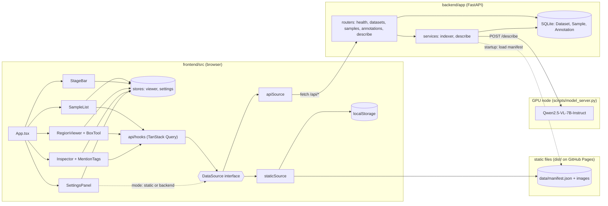
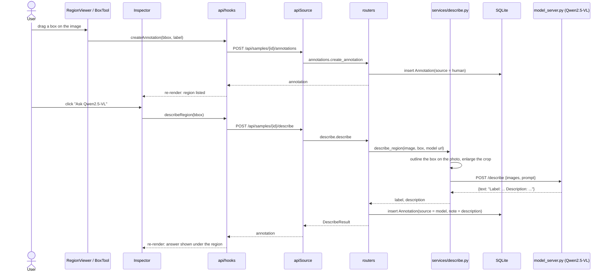

# Visual read-out

A web viewer for one kind of research data: a photo, a region of that photo, and what a vision-language model says about that region.

Live: **https://nkn002.github.io/visual-readout/** · DS7400 Deep Learning, Homework 1 · Author: Khai-Nguyen Nguyen

## The goal

A user opens an image, draws a region, and asks Qwen2.5-VL what is in it. A **Default region** button reveals the region the research dataset defined for that image and the text a verbalizer produced for it. Users can record their own verdicts and save everything. HW1 delivers that viewer; later homeworks add trained models on top of it.

The research behind the data maps Qwen2.5-VL region activations into a frozen text verbalizer through a small trained connector. The viewer is the tool for looking at those regions and read-outs one at a time.

**Data type:** images plus boxes plus text. A sample is one Visual Genome region: an image, a box `[x, y, w, h]`, the phrase describing it, the verbalizer's read-out, and a judge's verdict. The committed sample has 12 regions.

## What you can do

| Feature | Where in the code |
|---|---|
| Browse the 12 images with thumbnails and arrow keys | `frontend/src/components/SampleList.tsx` |
| Zoom and pan the image | `frontend/src/features/viewer/RegionViewer.tsx` |
| **Annotation:** drag to draw a labelled region; delete; export and import as JSON | `frontend/src/features/annotate/BoxTool.tsx`, `Inspector.tsx` |
| **Ask Qwen2.5-VL** what a drawn region contains | `backend/app/services/describe.py`, `scripts/model_server.py` |
| **Default region:** reveal the dataset's box, its phrase, and the frozen verbalizer's read-out with the judge's verdict | `StageBar.tsx`, `Inspector.tsx` |
| Give your own names-it / misses-it verdict on that read-out | `frontend/src/features/annotate/MentionTags.tsx` |
| **Backend:** annotations persist in SQLite through a FastAPI service | `backend/app/` |
| Two data modes behind one interface: static (GitHub Pages) or backend | `frontend/src/api/` |
| Deploy to GitHub Pages on every push | `.github/workflows/pages.yml` |

Implemented annotation: **yes**. Implemented backend/database: **yes** (SQLite via SQLModel; tables are created at startup, migrations are a follow-up). Model in the loop: **yes**, Qwen2.5-VL-7B-Instruct on a cluster GPU, prompted directly.

## Run it

Static mode, what the live page does, no server:

```bash
python backend/app/services/scan.py --data data/sample --out frontend/public/data   # stage the sample
cd frontend && npm ci && npm run dev                                                # http://localhost:5173
```

Backend mode, annotations persist and the model can be asked:

```bash
cd backend && python3 -m venv .venv && .venv/bin/pip install -e ".[dev]"
.venv/bin/uvicorn app.main:app --reload            # http://localhost:8000, docs at /docs
```

In the app open **Settings** (the pill in the top bar), choose **Backend**, and check the connection. In local dev the Vite proxy forwards `/api` to port 8000, so the URL can stay empty. From the public page use `http://localhost:8000`; Chrome asks once for permission to reach localhost.

Both at once, with the right URLs inside a UVA Open OnDemand VS Code session: `scripts/dev.sh`.

The model, on the UVA cluster (needs a GPU):

```bash
sbatch scripts/model_server.sbatch        # Qwen2.5-VL-7B-Instruct on an RTX 3090, about 90 s to load
tail -f data/db/model_server.<jobid>.log  # "serving http://<node>:8100" when ready
```

The server writes its address to `data/db/model_server.url`; the backend reads that file on every request, so nothing restarts. Without it, the Ask button answers with a clear "not running" message.

Docker, both services with hot reload: `docker compose up`, then open http://localhost:5173.

Tests: `cd backend && .venv/bin/python -m pytest` (11 tests: indexing, endpoints, annotation round trip, import, manifest validation, the model call against a stand-in server).

## The repository, top down

Four folders each own one part of the goal:

- `data/` holds the images and text the viewer shows.
- `frontend/` is the web page the user interacts with.
- `backend/` saves what the user does and talks to the model.
- `scripts/` starts everything, on a laptop or on the UVA cluster.

Beside them: `docs/DESIGN.md` (why it is built this way), `compose.yml` (frontend and backend together in Docker), `.env.example` (the settings the backend reads), and `.github/workflows/` (publishing and tests).

### `data/` — what the viewer shows

- `sample/` is the only data committed. It is small (12 images, 3 MB) so the app works from a fresh clone and on GitHub Pages.
  - `manifest.json` is the index of the 12 samples. For each one it lists the image files, the region box, the phrase, the read-out text of each verbalizer arm, and the judge's verdict. The web page and the backend both read this one file, so they always agree on what a sample is.
  - `images/` holds the JPEGs, four per sample: the original and three edited versions. HW1 shows the original; the edits are for later homeworks.
- `raw/` and `db/` are ignored by git. `raw/` is for the full dataset, `db/` for the SQLite database and the model server's address.

### `frontend/` — the page the user sees

Built with React and Vite. The source is in `src/`; `npm run build` compiles it into `dist/`, a plain static site, which is what GitHub Pages serves.

- `main.tsx` starts the app. `App.tsx` lays out the three panes and handles keyboard shortcuts.
- `components/` — the panes and bars.
  - `SampleList.tsx`: the left column, one thumbnail per image.
  - `StageBar.tsx`: above the image, the drawing tool and the **Default region** button.
  - `Inspector.tsx`: the right column. The user's regions with an **Ask Qwen2.5-VL** button each, the default region's phrase and read-out when revealed, and export/import.
  - `Header.tsx`: the title and the data-source badge. `SettingsPanel.tsx`: switch between static mode and backend mode.
- `features/viewer/` — the image itself.
  - `RegionViewer.tsx` shows the photo with zoom and pan and draws boxes over it.
  - `types.ts` is the contract every viewer satisfies; `registry.ts` maps a data kind to its viewer, so a time-series or mesh viewer could plug in beside this one.
- `features/annotate/` — the two ways to annotate: `BoxTool.tsx` (drag to draw a region) and `MentionTags.tsx` (names-it / misses-it verdict on a read-out).
- `api/` — where the data comes from. `source.ts` defines one interface; `staticSource.ts` fulfils it from `manifest.json` and the browser's local storage; `apiSource.ts` fulfils it from the backend. `hooks.ts` gives the components one way to ask for data, so they never know which source answered.
- `stores/` — small pieces of UI state: the selected image, the active tool, whether the default region is shown, and the chosen data source.
- `types/api.ts` — the TypeScript shapes of samples and annotations, matching `manifest.json` and the backend.
- `index.css` — all styling, light and dark.

### `backend/` — saving and asking the model

A FastAPI service with a SQLite database. Everything is in `app/`:

- `main.py` creates the service. At startup it creates the tables and loads `manifest.json` into the database.
- `config.py` reads settings from `.env`: where the data is, where the database is, and where the model server is.
- `models.py` defines the three tables: Dataset, Sample, Annotation. An annotation is a box, a point, or a verdict, with a `source` of `human` or `model`.
- `schemas.py` defines what requests and responses look like.
- `routers/` — the endpoints, one file per resource: `health.py` (is it up, is the model up), `datasets.py` and `samples.py` (list samples, serve images), `annotations.py` (create, list, delete, export, import), `describe.py` (ask the model about a box).
- `services/` — the logic behind the endpoints: `scan.py` validates the manifest and copies it into the web build; `indexer.py` loads it into SQLite; `describe.py` outlines the user's box on the photo, enlarges the crop, sends both to the model server, and parses the answer.
- `tests/` — 11 tests that run the whole service against the sample data.

### `scripts/` — running it

- `export_sample.py` builds `data/sample/` from the research repository. Run once when the data changes.
- `dev.sh` starts the frontend and backend and prints the URLs, including the proxy addresses needed inside the cluster's VS Code sessions.
- `model_server.py` loads Qwen2.5-VL-7B-Instruct on a GPU and answers "what is in this box" over HTTP. `model_server.sbatch` runs it as a Slurm job.

### `.github/workflows/` — publishing

`pages.yml` builds the frontend and deploys it to `nkn002.github.io/visual-readout` on every push to `main`. `test.yml` runs the backend tests and the frontend build on every push.

## How the components interact

### Components

Arrows point from the caller to what it uses. The screens only ever talk to `DataSource`; which implementation is behind it depends on the mode chosen in Settings.



### Data model

The same three shapes exist in `manifest.json`, in SQLite, and in `frontend/src/types/api.ts`.

```mermaid
classDiagram
  class Dataset {
    id
    name
    kind = "region"
    conditions
    arms
  }
  class Sample {
    id
    dataset_id
    image_id
    phrase
    head
    box [x, y, w, h] px
    images {condition: file}
    readouts {arm: {condition: text}}
    judge {arm: {condition: verdict}}
  }
  class Annotation {
    id (UUID)
    sample_id
    label
    note
    geometry
    source: human | model
    created_at
  }
  class Geometry {
    <<union>>
    bbox x y w h (0..1)
    point x y
    tag arm condition value
  }
  Dataset "1" --> "*" Sample
  Sample "1" --> "*" Annotation
  Annotation --> Geometry
```

### Drawing a region and asking the model



In static mode the first half is the same, except `staticSource` writes to `localStorage` instead of calling the backend, and the Ask button explains that it needs the backend.

## How the parts meet

Two modes, one interface. On GitHub Pages there is no server, so the page reads `manifest.json` directly and keeps annotations in the browser. With the backend running, the same page saves to SQLite and can ask Qwen. The user switches in Settings; the components do not change.

Annotations are rows `{id, sample_id, label, note, geometry, source, created_at}`. `geometry` is JSON: `{"type": "bbox", x, y, w, h}` in normalised image coordinates, `{"type": "point", x, y}`, or `{"type": "tag", arm, condition, value}`. A model answer is a row with `source = "model"`, the short label in `label` and the sentence in `note`. IDs are UUIDs made in the browser, so a JSON export from static mode imports into the database without collisions.

## Libraries

Frontend: React 19, Vite 8, TypeScript, TanStack Query (server data), Zustand (UI state), react-zoom-pan-pinch (zoom and pan). Backend: FastAPI, SQLModel (SQLAlchemy + Pydantic), SQLite, pydantic-settings, Pillow, httpx, pytest. Model server: PyTorch, Transformers, Qwen2.5-VL-7B-Instruct.
