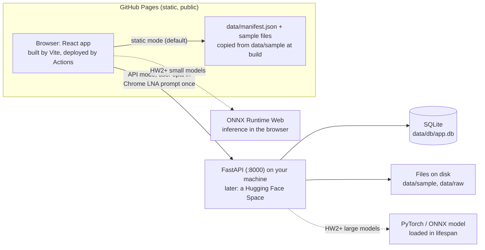

# Visual read-out — Design Doc

**DS7400 Deep Learning · Homework 1**

| | |
|---|---|
| Status | Rev 3: implemented for HW1 (see status note in section 13) |
| Author | rbc5xp (UVA) |
| Written | 2026-09-20 |
| HW1 due | 2026-09-21, 11:59 PM ET |
| Data type | Visual Genome regions with verbalizer read-outs (`kind = region`) |
| Stack | React + Vite + TypeScript / FastAPI + SQLModel + SQLite |
| Hosting | https://nkn002.github.io/visual-readout/ (GitHub Pages). Backend on your machine now, Hugging Face Space later. |
| Repo | https://github.com/nkn002/visual-readout |
| Web version | https://claude.ai/artifact/GMXKiUiBTzwFS6KVLgpMYk |

A web application that starts as a viewer for one research dataset and grows, homework by homework, into an interactive deep learning tool. The viewer is a project site on GitHub Pages under the author's existing account (https://nkn002.github.io/), so every push to `main` publishes a link the grader can open. This document fixes the project structure before any code is written.

## Contents

1. [Context and scope](#1-context-and-scope)
2. [Goals and non-goals](#2-goals-and-non-goals)
3. [System overview](#3-system-overview)
4. [Repository layout](#4-repository-layout)
5. [Frontend design](#5-frontend-design)
6. [Backend design](#6-backend-design)
7. [Data model and API](#7-data-model-and-api)
8. [Datasets and privacy](#8-datasets-and-privacy)
9. [Environments: local and GitHub Pages](#9-environments-local-and-github-pages)
10. [Viewer options by data type](#10-viewer-options-by-data-type)
11. [Alternatives considered](#11-alternatives-considered)
12. [Cross-cutting concerns](#12-cross-cutting-concerns)
13. [Milestones](#13-milestones)
14. [Open questions](#14-open-questions)
15. [References](#15-references)

---

## 1. Context and scope

The course builds one application incrementally. HW1 asks for a minimally functional web-based viewer for the data type you expect to use all semester (80 points), with optional annotation (+10) and a backend database scaffold (+10). Later homeworks add classification, detection, segmentation, and generative models on top of this same app.

This design isolates everything data-specific behind one component contract and one JSON column, so switching the data type changes a single viewer file and a sample folder, not the architecture.

**The data (decided 2026-09-20).** The research project is `nkn002/nla`, a study of mapping Qwen2.5-VL region activations into a frozen natural language autoencoder through a small trained connector. A sample is one Visual Genome region: an image, a box `[x, y, w, h]`, the VG phrase, and, for each of five verbalizer arms, the read-out text under four image edits (original, content swap, context swap, box blank) plus an LLM judge's verdict on whether the read-out names the object. The dataset kind is `region`. The committed sample is the 12 counterfactual regions that already have their edited images exported: 48 JPEGs, 3.3 MB. `scripts/export_sample.py` builds it from the research repo's `results/data/` and writes the manifest the app reads.

The frontend will be hosted on GitHub Pages. The author already runs two sites there: a personal homepage (https://nkn002.github.io/, Jekyll with the AcademicPages theme, built by GitHub from the `master` branch) and a paper page (https://vlmsarebiased.github.io/, hand-written HTML). This project keeps the same hosting and the same habit, push and it is live, but the site is a Vite build of React components rather than Jekyll templates or hand-written HTML, because an app with selection state, tools, and annotations outgrows a static page by HW2. Two consequences follow. Pages builds Jekyll for you but not Vite, so a small GitHub Actions workflow does the build. And Pages serves files only, so the design has to say how a static site talks to a Python backend and what it does when there is none.

The instructor's grading rubric is the primary constraint: a viewer the user can open in a browser, select and explore data, plus a 3-minute demo video and a GitHub repo with a README. Everything else here is in service of the later homeworks.

## 2. Goals and non-goals

### Goals

- Ship a working viewer by the HW1 deadline: list samples, select one, view it with zoom and pan, see its metadata.
- Live at a `github.io` URL on every push to `main`, working with zero setup from the committed sample data.
- Earn both extra credits with the same scaffold: annotations are stored in SQLite through a FastAPI endpoint when the backend is running.
- Make the data type swappable. One viewer component per kind, registered by name.
- Leave obvious seams for HW2 to HW4: a `/predict` endpoint, in-browser ONNX inference for small models, a model-output shape that reuses the annotation table, and a place to load a PyTorch model once at startup.
- Keep the codebase small enough that the author can explain every folder, which the assignment explicitly requires.

### Non-goals

- No authentication, multi-user support, or a hosted backend in HW1.
- No deep learning in HW1. No model files, no GPU code.
- No support for more than one data type at a time in the UI. The registry allows it, but HW1 ships one viewer.
- No full dataset in the repository or on the Pages site. A small committed sample is the only data GitHub ever sees.

## 3. System overview

The frontend is a static React bundle on GitHub Pages. GitHub Pages cannot run Python, so the app has two data modes behind one interface, and the user picks the mode in a settings panel.

- **Static mode** is the default. At build time a script copies `data/sample/` into the bundle and writes `data/manifest.json` listing every sample. The app reads that file, serves images straight from the Pages CDN, and keeps annotations in `localStorage` with JSON export and import. This is what the grader sees at the link, with nothing to install.
- **API mode** is opt-in. The user enters a backend URL (default `http://localhost:8000`) and the same screens now read samples and write annotations through FastAPI, which stores them in SQLite. Chrome shows a one-time Local Network Access permission prompt when a public https page calls localhost, and once allowed the requests go through. This is the +10 backend credit and, from HW2, where a PyTorch model runs.



> **Decision.** Two modes, one interface. API-only would leave the Pages link broken for anyone without the backend running. Static-only would forfeit the database credit and give HW2 nowhere to run a model. A `DataSource` interface with two implementations costs about 150 lines and makes both true.

> **Decision.** Python backend from day one. The models in HW2 to HW4 will be PyTorch, so keeping the server in Python means inference is an import, not a new service. FastAPI is chosen over Flask for its automatic OpenAPI docs at `/docs`, typed request and response models, and first-class async.

## 4. Repository layout

One GitHub repository holds both halves, modeled on the official FastAPI full-stack template. The two apps stay independent (separate package managers, separate Dockerfiles) but share one Compose file, one `.env`, one data folder, and one Pages workflow.

```
<repo>/
├── README.md                    # required by the submission rubric
├── docs/DESIGN.md               # this document
├── .github/workflows/pages.yml  # build manifest + Vite, deploy to GitHub Pages
├── compose.yml                  # frontend + backend + data bind mount
├── .env.example                 # DATA_DIR, DATABASE_URL, VITE_BASE; copy to .env
├── .gitignore                   # data/raw, data/db, frontend/public/data, .env, node_modules, dist
├── data/
│   ├── sample/                  # 20 to 50 small public files, committed, served on Pages
│   ├── raw/                     # full dataset, git-ignored
│   └── db/                      # app.db (SQLite), git-ignored
├── frontend/                    # React 19 + Vite + TypeScript
└── backend/                     # FastAPI + SQLModel + Alembic
```

> **Decision.** Monorepo, not two repos. The assignment wants one link. One repo also keeps the README, the Compose file, the Pages workflow, and the sample data next to the code that uses them. The repo name sets the Pages URL, `https://nkn002.github.io/<repo>/` (section 9).

## 5. Frontend design

Scaffolded with `npm create vite@latest frontend -- --template react-ts`. The folder structure starts technical (components, hooks, stores) and adds a `features/` folder only for the two domain areas that will grow: the viewer and annotation. Imports flow one way: shared code into features, features into `App.tsx`, never feature to feature.

```
frontend/
├── index.html
├── vite.config.ts               # base from VITE_BASE; dev proxy /api -> backend
├── package.json
├── public/data/                 # generated: manifest.json + sample files (git-ignored)
└── src/
    ├── main.tsx                 # React root, QueryClientProvider
    ├── App.tsx                  # 3-pane layout: list | viewer | inspector
    ├── api/
    │   ├── source.ts            # DataSource interface + useDataSource()
    │   ├── staticSource.ts      # manifest.json + localStorage annotations
    │   └── apiSource.ts         # fetch `${apiBase}/api/...`
    ├── components/              # Layout, SampleList, Inspector, Toolbar, SettingsPanel
    ├── features/
    │   ├── viewer/
    │   │   ├── types.ts         # ViewerProps contract
    │   │   ├── registry.ts      # kind -> viewer component
    │   │   └── ImageViewer.tsx  # HW1 placeholder viewer
    │   └── annotate/
    │       ├── useAnnotations.ts
    │       └── BoxTool.tsx      # or PointTool / RangeTool per kind
    ├── stores/
    │   ├── viewerStore.ts       # zustand: selected id, zoom, active tool
    │   └── settingsStore.ts     # zustand, persisted: mode, apiBase
    ├── types/api.ts             # mirrors backend schemas and manifest.json
    └── styles/
```

### The data source contract

Every screen talks to one interface. The settings store decides which implementation is active, and TanStack Query hooks call whichever it is. Nothing in `features/` knows whether a sample came from a JSON file on the CDN or from SQLite.

```ts
export interface DataSource {
  listDatasets(): Promise<Dataset[]>;
  listSamples(datasetId: string, page: { offset: number; limit: number }): Promise<Sample[]>;
  fileUrl(sample: Sample): string;            // "/data/sample/x.png" or "http://host/api/samples/x/file"
  listAnnotations(sampleId: string): Promise<Annotation[]>;
  createAnnotation(a: AnnotationCreate): Promise<Annotation>;
  deleteAnnotation(id: string): Promise<void>;
}
```

IDs are strings in both modes: a sample's id is its path relative to the data folder, and an annotation's id is a UUID generated in the browser. That means annotations made in static mode can be exported as JSON and imported into SQLite later without collisions, which is a natural HW2 feature.

### The viewer contract

Every data type implements the same props. The registry maps a dataset's `kind` string to a component, and `App.tsx` renders whichever one matches the selected dataset. HW1 registers one entry.

```ts
export interface ViewerProps {
  sample: Sample;                     // metadata plus fileUrl
  annotations: Annotation[];
  tool: "select" | "box" | "point" | "range";
  onCreate(a: AnnotationCreate): void;
  onSelect(id: string | null): void;
}

export const viewers: Record<DatasetKind, React.FC<ViewerProps>> = {
  image: ImageViewer,
  // timeseries: TimeSeriesViewer,  mesh: MeshViewer,  geo: MapViewer, ...
};
```

### State

- **Server data** (datasets, samples, annotations) lives in TanStack Query. It handles caching, loading states, and refetch after a mutation, which removes most hand-written `useEffect` fetching, and it does not care which `DataSource` answered.
- **Viewer UI state** (selected sample, zoom level, active tool, in-progress shape) lives in one small Zustand store. It changes on every mouse move, so it stays out of React context.
- **Settings** (mode, backend URL) live in a second Zustand store with the `persist` middleware, so the choice survives a reload of the Pages site.
- **No Redux.** Two libraries, three small files, no boilerplate.

> **Decision.** TypeScript, not JavaScript. The API types mirror the backend's Pydantic schemas and the manifest, so a renamed field fails at compile time instead of as a blank panel during the demo.

## 6. Backend design

The official "bigger applications" layout: an `app` package, one `APIRouter` per resource, a settings object read from `.env`, and a database session provided as a `yield` dependency. Files are kept by type (routers, models, schemas, services) rather than by domain because the service is small.

```
backend/
├── pyproject.toml               # fastapi, sqlmodel, uvicorn, alembic, pydantic-settings
├── Dockerfile
├── alembic.ini
├── alembic/versions/
├── app/
│   ├── main.py                  # create_app(), CORS, lifespan, include_router
│   ├── config.py                # Settings(BaseSettings): DATA_DIR, DATABASE_URL, CORS_ORIGINS
│   ├── database.py              # engine, get_session (yield)
│   ├── models.py                # Dataset, Sample, Annotation tables
│   ├── schemas.py               # *Read / *Create request and response models
│   ├── routers/
│   │   ├── datasets.py
│   │   ├── samples.py           # metadata + FileResponse for the raw file
│   │   └── annotations.py
│   └── services/
│       ├── scan.py              # stdlib only: walk a data dir -> manifest dict; has a CLI
│       └── indexer.py           # scan() -> Dataset and Sample rows
└── tests/
    ├── conftest.py              # TestClient + temporary SQLite file
    └── test_api.py
```

`scan.py` is the one definition of "what is a sample". It walks a folder, infers each dataset's kind from file extensions or a `dataset.json` sidecar, and returns the manifest structure. The Pages workflow runs it as a script (`python backend/app/services/scan.py --data data/sample --out frontend/public/data`) to build static mode, and the indexer calls the same function at startup inside `lifespan` to fill SQLite for API mode. It depends on nothing outside the standard library so CI does not need to install the backend. Re-indexing is idempotent, keyed on the relative path. In HW2 the same `lifespan` block loads the model into a module-level dict once, never per request.

> **Decision.** SQLModel over plain SQLAlchemy. One class is both the table and the Pydantic schema, which halves the model code. Alembic is set up now, even though HW1 could get by with `create_all()`, because the schema will grow in every homework and `create_all()` never alters existing tables.

## 7. Data model and API

### Tables and the manifest

The manifest that static mode reads and the tables that API mode reads have the same fields, so `types/api.ts` is written once.

| Table | Columns | Added in |
|---|---|---|
| Dataset | `id` (folder name), `name`, `kind`, `root_path`, `created_at` | HW1 |
| Sample | `id` (relative path, primary key), `dataset_id`, `filename`, `mime_type`, `size_bytes`, `meta` (JSON) | HW1 |
| Annotation | `id` (UUID, client-generated), `sample_id`, `label`, `geometry` (JSON), `source` (`human` \| `model`), `created_at` | HW1 (+10) |
| Model | `id`, `name`, `task`, `version`, `path` | HW2 |
| Prediction | `id`, `sample_id`, `model_id`, `output` (JSON), `created_at` | HW2 |

```jsonc
// frontend/public/data/manifest.json, generated by scan.py
{
  "datasets": [{
    "id": "sample", "name": "Sample", "kind": "image",
    "samples": [
      { "id": "sample/img_001.png", "filename": "img_001.png", "mime_type": "image/png", "size_bytes": 48211, "meta": {} }
    ]
  }]
}
```

The `geometry` column is the second seam that keeps the design generic. It is a JSON object whose `type` field says how to draw it, and coordinates are normalized where that makes sense so the same row survives a resize.

```jsonc
{ "type": "bbox",    "x": 0.12, "y": 0.30, "w": 0.25, "h": 0.18 }   // images, video frames
{ "type": "point",   "x": 0.50, "y": 0.50 }                          // images, medical slices
{ "type": "range",   "start": 12.5, "end": 14.0, "channel": "ax" }  // time series, audio
{ "type": "point3d", "x": 1.2, "y": -0.4, "z": 3.1 }                 // meshes, point clouds
{ "type": "geo",     "lat": 38.03, "lon": -78.51 }                    // maps
```

Model outputs in HW3 (detection boxes) are stored as `Annotation` rows with `source = "model"`, so the viewer draws predictions with the exact code path it already uses for human labels.

### Endpoints

| Method | Path | Purpose | Added in |
|---|---|---|---|
| GET | `/api/health` | Liveness check; the settings panel calls it to show "connected" | HW1 |
| GET | `/api/datasets` | List datasets with kind and sample count | HW1 |
| GET | `/api/datasets/{id}/samples` | Paged sample list, `?offset&limit&q` | HW1 |
| GET | `/api/samples/{id}` | One sample's metadata | HW1 |
| GET | `/api/samples/{id}/file` | The raw file, served with `FileResponse` | HW1 |
| GET, POST | `/api/samples/{id}/annotations` | List or create annotations | HW1 (+10) |
| DELETE | `/api/annotations/{id}` | Remove one annotation | HW1 (+10) |
| POST | `/api/annotations/import` | Bulk insert annotations exported from static mode | HW2 |
| POST | `/api/samples/{id}/predict` | Run the loaded model, return JSON labels or boxes | HW2 |
| GET | `/api/jobs/{id}` | Poll a slow job started with `BackgroundTasks` | HW3+ |

All routes are plain `def`, not `async def`. FastAPI runs them in a threadpool, which is correct for SQLite and, later, for CPU-bound inference that must not block the event loop. `CORS_ORIGINS` lists `http://localhost:5173` and the Pages origin (`https://<user>.github.io`), because API mode is a cross-origin call from the Pages site.

## 8. Datasets and privacy

Three folders under `data/` with three different rules.

- **`data/sample/`** is committed and published. It holds 20 to 50 small files, under a few megabytes total, that make the app work on a fresh clone and at the Pages URL. Because GitHub Pages sites are public, this folder must contain public or synthetic data, never restricted research data, even if the repository itself is private.
- **`data/raw/`** is git-ignored and treated as immutable. The indexer reads it when `DATA_DIR` points there, so the full dataset is only ever visible in API mode on the author's own machine. Nothing writes to it.
- **`data/db/`** is git-ignored. It holds the SQLite file, which is derived state and can always be rebuilt by the indexer.

Paths live in `.env`, which is ignored, and are documented in `.env.example`, which is committed. GitHub warns at 50 MB per file and rejects 100 MB, and a Pages site should stay well under 1 GB, so the ignore rules are a hard requirement, not tidiness. If the full dataset ever needs versioning, DVC is the upgrade path: `dvc add data/raw` writes a small pointer file and pushes bytes to any remote, without changing this layout.

## 9. Environments: local and GitHub Pages

Three ways to run, same code.

### Native

Day-to-day work: `uvicorn app.main:app --reload` in `backend/` and `npm run dev` in `frontend/`. The Vite dev server proxies `/api` to the backend, so both are on loopback and no browser prompt appears. This is the only option on the UVA HPC login nodes, where Docker is not available.

```ts
// vite.config.ts
export default defineConfig({
  base: process.env.VITE_BASE ?? "/",                 // "/<repo>/" on Pages, "/" for a *.github.io repo
  server: {
    host: true,
    proxy: { "/api": { target: process.env.VITE_API_TARGET ?? "http://localhost:8000", changeOrigin: true } },
  },
});
```

### Compose

Proves the "FastAPI + SQLite + Docker" scaffold for the extra credit and gives the grader a one-command start. Source is bind-mounted so hot reload works in both containers. SQLite is opened with `check_same_thread=False`, which FastAPI requires because one request can touch the session from more than one thread. On Docker Desktop or WSL2, `server.watch.usePolling` is the fix if hot reload does not fire.

```yaml
services:
  backend:
    build: ./backend
    command: uvicorn app.main:app --host 0.0.0.0 --port 8000 --reload
    volumes: ["./backend:/code", "./data:/data"]
    env_file: .env
    ports: ["8000:8000"]
  frontend:
    image: node:22-alpine
    working_dir: /app
    command: sh -c "npm ci && npm run dev -- --host 0.0.0.0"
    environment: { VITE_API_TARGET: "http://backend:8000" }
    volumes: ["./frontend:/app", "/app/node_modules"]
    ports: ["5173:5173"]
    depends_on: [backend]
```

### GitHub Pages

The workflow below runs on every push to `main`. It generates the manifest, builds the Vite bundle with the right base path, and deploys it. Two settings differ from the personal site: the Pages source is "GitHub Actions" instead of "Deploy from a branch" (Settings → Pages → Source), and the branch is `main`, GitHub's current default, rather than `master`. There is no Jekyll step and no committed build output; Actions uploads `frontend/dist` directly, so Jekyll's rule of ignoring underscore-prefixed files never applies.

```yaml
# .github/workflows/pages.yml
name: pages
on: { push: { branches: [main] } }
permissions: { contents: read, pages: write, id-token: write }
jobs:
  build:
    runs-on: ubuntu-latest
    steps:
      - uses: actions/checkout@v4
      - uses: actions/setup-python@v5
        with: { python-version: "3.12" }
      - run: python backend/app/services/scan.py --data data/sample --out frontend/public/data
      - uses: actions/setup-node@v4
        with: { node-version: 22, cache: npm, cache-dependency-path: frontend/package-lock.json }
      - run: npm ci && npm run build
        working-directory: frontend
        env: { VITE_BASE: "/${{ github.event.repository.name }}/" }
      - uses: actions/upload-pages-artifact@v3
        with: { path: frontend/dist }
  deploy:
    needs: build
    runs-on: ubuntu-latest
    environment: { name: github-pages }
    steps:
      - uses: actions/deploy-pages@v4
```

The site publishes at `https://nkn002.github.io/<repo>/`, beside the Jekyll homepage, which keeps the root. Project sites share the user site's domain, so the only constraint is that the repo name does not collide with a path the homepage uses (`/publications/`, `/cv/`, and so on). The workflow sets `VITE_BASE=/<repo>/` from the repo name automatically. If a root URL is ever wanted, a dedicated organization with a `<org>.github.io` repo, as with the paper site, needs `VITE_BASE=/` and nothing else.

If the Actions setup feels foreign, the fallback that matches the personal site's "Deploy from a branch" setting is the `gh-pages` npm package: `npm run deploy` builds and pushes `dist/` to a `gh-pages` branch, and Pages serves that branch. It works, but it puts build output in git and needs a local Node toolchain for every deploy, so Actions is the default.

### Connecting the Pages site to a local backend

In API mode the public https page calls `http://localhost:8000`. Chrome 142 and later shows a Local Network Access permission prompt the first time, and once the user allows it the requests are exempt from mixed-content blocking. The backend needs no special header beyond the CORS origin. This is the path the demo video will show: open the Pages URL, browse in static mode, open settings, connect to the local backend, annotate, show the row in SQLite.

Firefox and Safari were not verified for this https-to-localhost path. The fallback in any browser is to run the frontend natively, where both ends are loopback. This only affects API mode; static mode works everywhere.

## 10. Viewer options by data type

Whichever row is chosen becomes the one registered viewer for HW1. Each pick is the simplest library that gives zoom, pan, and a natural annotation gesture without custom canvas code. All of them are client-side and work unchanged on GitHub Pages.

| Data type | Sample format | Viewer library | Annotation gesture | HW2 direction |
|---|---|---|---|---|
| Images | PNG / JPG | `react-zoom-pan-pinch` | Drag a box, click a point (`react-konva` overlay) | Classification, then detection |
| Time series | CSV, one file per recording | `react-plotly.js` | Drag a time range on the plot | Forecasting, anomaly detection |
| 3D meshes | STL / OBJ / PLY | `@react-three/fiber` + `drei` | Click a point on the surface | Shape classification, segmentation |
| Geographic | CSV or GeoJSON | `react-leaflet` | Drop a marker | Spatial prediction, clustering |
| Audio | WAV | `@wavesurfer/react` | Regions plugin, drag a segment | Sound classification |
| Video | MP4 | HTML5 `<video>` | Mark a timestamp, box on a frame | Action recognition |
| Medical volumes | NIfTI / DICOM, pre-sliced to PNG | Same as images, plus a slice slider | Point or box on a slice | Segmentation |

> **If still undecided tomorrow.** Build the image row against a public subset (for example 50 images from a Kaggle or torchvision dataset placed in `data/sample/`). Everything else in this document stays valid when the real data type is chosen later; the cost of switching is one viewer component and one sample folder.

## 11. Alternatives considered

| Decision | Chosen | Rejected | Why |
|---|---|---|---|
| Frontend hosting | GitHub Pages via Actions | Vercel or Netlify; localhost only | Already familiar from the paper site, free, and every push publishes a link for the grader. Vercel adds an account and buys nothing for a static bundle. Localhost-only means the grader can only see the video. |
| Frontend tech | React + Vite | Hand-written HTML + Bulma like the paper site; Next.js; Streamlit or Gradio | The paper site is a document; this is an app with selection, tools, and annotations that grows for four homeworks. Vite's output is the same kind of static bundle. Next.js adds server rendering Pages cannot run. Streamlit fights custom interaction and cannot be hosted on Pages. |
| Data access | Dual-mode `DataSource` | API-only; static-only | API-only leaves the Pages link broken without a backend. Static-only forfeits the database credit and gives HW2 nowhere to run a large model. |
| Language | TypeScript | JavaScript | API types mirror the backend and the manifest. The extra syntax is small for a viewer, and the Vite template already ships TS. |
| Backend | FastAPI | Flask; Express (Node) | Same language as the models. Flask needs extra libraries for typed schemas and OpenAPI. Express would put inference behind a second service. |
| Backend hosting (HW2+) | Local, then a Hugging Face Space | Render; Fly.io | A Docker Space runs the same image as Compose for free on CPU, and it is where ML demos already live. Not needed for HW1. |
| Database | SQLite | Postgres | Zero operations, one file, rebuildable. Swapping is one `DATABASE_URL` change if Postgres is ever needed. |
| ORM | SQLModel + Alembic | Raw SQLAlchemy; `sqlite3` by hand; no migrations | SQLModel halves the model code. Skipping migrations is fine for one homework and a trap for four. |
| Client state | TanStack Query + Zustand | Redux Toolkit; Context only | Redux is boilerplate for this size. Context re-renders the tree on every zoom change. |
| Folder structure | Technical folders plus two features | Full bulletproof-react; one flat `src/` | Full feature slicing is more structure than a solo project needs. Flat stops working once annotation and inference arrive. |
| Data in git | Committed sample subset | Git LFS; DVC now | A subset needs no tooling and satisfies the rubric. DVC stays as the upgrade path. |
| Where inference runs (HW2+) | Small models in the browser with ONNX Runtime Web; large models behind FastAPI | Server-only; a Celery worker | In-browser inference keeps the Pages site self-contained for a classifier of tens of MB. Server-side keeps large models and GPU access simple. Celery only if a job must leave the process. |

## 12. Cross-cutting concerns

- **Privacy.** The Pages site is public on the internet. Only `data/sample/` is published, and it must contain public or synthetic files if the research data is human-subject or otherwise restricted. Raw data stays on the author's machine and is only reachable in API mode from that machine. The demo video should also avoid showing restricted data.
- **Secrets.** HW1 needs none. `.env` is ignored from the first commit so a key added in HW2 cannot be leaked by accident. The Pages build is public, so no secret may ever be read through `import.meta.env`.
- **Testing.** Backend: pytest with `TestClient` and a temporary SQLite file created in `conftest.py`, covering `scan.py`, the indexer, and each router. Frontend: a Vitest test that `staticSource` parses a manifest fixture, and a smoke test that the app renders. The Pages workflow is itself a build check on every push.
- **Reproducibility.** Pinned dependencies (`package-lock.json`, `uv.lock` or `requirements.txt`), Node and Python versions in the README and the workflow, Compose as the reference environment.
- **Observability.** FastAPI's `/docs` page doubles as a manual test console and a demo prop. The settings panel shows the `/api/health` result so a failed connection is visible, not silent. Uvicorn access logs are sufficient.
- **Interaction quality.** Keyboard navigation between samples (arrow keys), a visible loading state, a "static / connected" badge in the header, and an error banner that shows the API message rather than failing silently.
- **Understanding.** The rubric requires the author to explain the app's components, data flow, libraries, start-up, and how to direct an agent to modify it. The README's "Architecture" section is written from this document, and each folder gets a one-line comment in the tree.

## 13. Milestones

> **Implementation status (2026-09-20).** HW1 steps 1 to 4 are built and tested: 8 backend tests pass, the Vite build passes, the static and backend modes both serve the sample, and CORS admits the Pages origin. One deviation from this document: Alembic is not set up yet. The schema is created with `create_all()` at startup and migrations are a follow-up for HW2, when the `Model` and `Prediction` tables arrive.

HW1 is due tomorrow night, so the build order is chosen so that each step leaves a demo-able app, and the Pages link goes live in the first hour so deployment is never the last-minute risk. Time estimates assume an agent writes most of the code and the author reviews it.

| Step | Deliverable | Detail | Est. |
|---|---|---|---|
| HW1 · 1 | Scaffold and first deploy | Repo, Vite template, FastAPI hello, `scan.py`, Pages workflow. Push; the hello page is live at the Pages URL and `/api/health` answers locally. | 1 h |
| HW1 · 2 | Static-mode viewer | Sample data committed, `staticSource`, sample list, viewer with zoom and pan, inspector with metadata, arrow-key navigation. Live on Pages. This alone is the 80 points. | 2 h |
| HW1 · 3 | Backend data path | Models, Alembic first migration, indexer, dataset and sample endpoints, file serving, CORS for the Pages origin. Verified in `/docs`. | 1.5 h |
| HW1 · 4 | Annotation (+10) and API mode (+10) | Annotation table and routes, `apiSource`, settings panel with backend URL and health badge, one drawing tool, label list in the inspector, delete, JSON export in static mode. Compose file. | 1.5 h |
| HW1 · 5 | Submit | README per rubric, push, record the 3-minute video: Pages URL in static mode, interactions, connect to local backend, annotate, show the SQLite row. | 1 h |
| HW2 | Classification | Export a fine-tuned classifier to ONNX; run it in the browser with ONNX Runtime Web so the Pages site classifies on its own. Add `Model` and `Prediction` tables and `/predict` for the server path. "Classify" button and confidence readout in the inspector. | |
| HW3 | Detection or event finding | Model outputs stored as `source = "model"` annotations and drawn by the existing overlay. Compare human versus model in the same view. Backend on a Hugging Face Space if the model is too large for the browser. | |
| HW4 | Segmentation or generation | Mask geometry type or a generated-sample dataset kind. Background jobs and `/jobs/{id}` polling if inference is slow. | |

## 14. Open questions

1. **Resolved: data type.** Visual Genome regions with verbalizer read-outs from the author's own research project (section 1).
2. **Is the real dataset shareable?** Decides whether `data/sample/` is a subset or a public stand-in. Anything in that folder is on the public internet once Pages deploys.
3. **Resolved: repo name.** `visual-readout`, at `https://nkn002.github.io/visual-readout/`. Still to do by hand: create the public repo on GitHub and set Settings → Pages → Source to GitHub Actions.
4. **Where will development happen?** The course folder is on the UVA HPC filesystem. Node and Python run there natively, but Docker does not, so the Compose scaffold needs a laptop or workstation to be verified once before submission.
5. **Browser for the demo.** Chrome is the verified path for connecting the Pages site to localhost. If the demo will be recorded in another browser, record the API-mode part from the native dev server instead.

## 15. References

1. FastAPI, Bigger Applications: https://fastapi.tiangolo.com/tutorial/bigger-applications/
2. FastAPI, SQL Databases (SQLModel, sessions, `check_same_thread`): https://fastapi.tiangolo.com/tutorial/sql-databases/
3. FastAPI, Settings and environment variables: https://fastapi.tiangolo.com/advanced/settings/
4. FastAPI, CORS: https://fastapi.tiangolo.com/tutorial/cors/
5. FastAPI, Lifespan events: https://fastapi.tiangolo.com/advanced/events/ and Background Tasks: https://fastapi.tiangolo.com/tutorial/background-tasks/
6. Full-stack FastAPI template (repo layout reference): https://github.com/fastapi/full-stack-fastapi-template
7. zhanymkanov, FastAPI best practices: https://github.com/zhanymkanov/fastapi-best-practices
8. bulletproof-react, project structure: https://github.com/alan2207/bulletproof-react/blob/master/docs/project-structure.md and state management: https://github.com/alan2207/bulletproof-react/blob/master/docs/state-management.md
9. Robin Wieruch, React folder structure: https://www.robinwieruch.de/react-folder-structure/
10. Vite server options (host, proxy, watch): https://vite.dev/config/server-options
11. Vite on GitHub Pages with Actions, worked example: https://github.com/sitek94/vite-deploy-demo and root-domain note: https://github.com/orgs/community/discussions/176242
12. Chrome, Local Network Access permission prompt: https://developer.chrome.com/blog/local-network-access
13. Cookiecutter Data Science, opinions on data folders: https://cookiecutter-data-science.drivendata.org/opinions/
14. DVC, Get started: https://doc.dvc.org/start
15. Design docs at Google (section template): https://www.industrialempathy.com/posts/design-docs-at-google/
16. Author's sites on GitHub Pages: personal homepage https://nkn002.github.io/ (Jekyll, AcademicPages theme, source https://github.com/nkn002/nkn002.github.io) and paper page https://vlmsarebiased.github.io/ (hand-written HTML)
17. Viewer libraries: react-zoom-pan-pinch https://github.com/BetterTypedProjects/react-zoom-pan-pinch · react-konva https://konvajs.org/docs/react/index.html · react-plotly.js https://github.com/plotly/react-plotly.js · react-three-fiber loading models https://r3f.docs.pmnd.rs/tutorials/loading-models · react-leaflet comparison https://blog.logrocket.com/react-map-library-comparison/ · @wavesurfer/react https://www.npmjs.com/package/@wavesurfer/react · Annotorious https://annotorious.dev/react/image-annotation/
18. ONNX Runtime Web: https://onnxruntime.ai/docs/tutorials/web/
