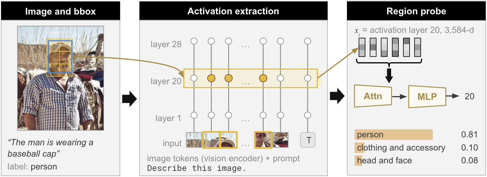
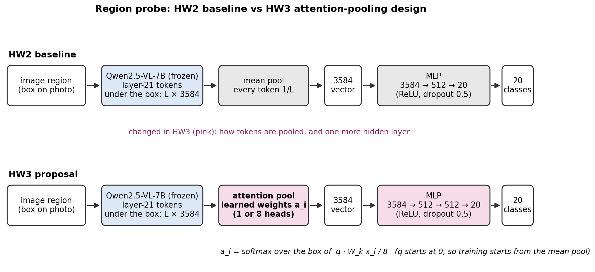
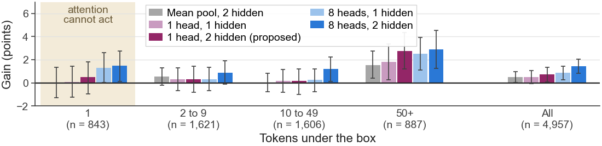
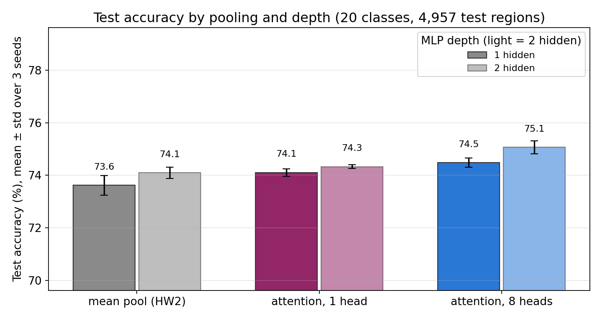
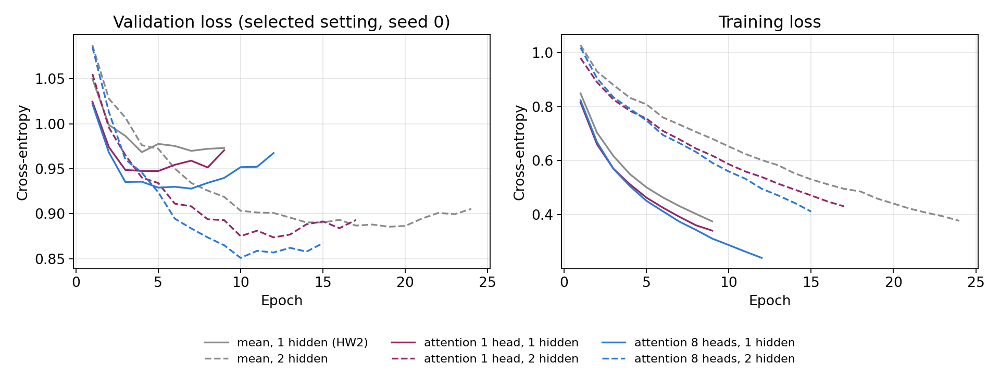

# HW3: attention pooling for the region probe

DS7400 Deep Learning, Homework 3 · Khai-Nguyen Nguyen · part of [visual-readout](../README.md); Homeworks 1 and 2 are in [README_HW1HW2.md](../README_HW1HW2.md)

The experiment report is [report.pdf](report.pdf). This page follows the report.

| Path | What it holds |
|---|---|
| `extract_tokens.py` | stores the layer-20 tokens under every box |
| `attention_probe.py` | the probe: mean or attention pooling, then an MLP |
| `train_hw3.py` | trains and evaluates the six probes |
| `hw3_contrasts.py` | bootstrap intervals by box size and by category |
| `results/` | one JSON per probe, per-item test correctness, the 1-head model |
| `figures/` | the figures on this page |
| `report.pdf` | the experiment report |

## Task and dataset



**The probe reads a frozen VLM's internal activations, not pixels.** Qwen2.5-VL-7B-Instruct encodes the image and the prompt. The probe takes the layer-20 activations at the image tokens under a Visual Genome bounding box and classifies the region into one of 20 object categories. In code, layer 20's output is `hidden_states[21]`.

**HW3 uses the HW2 data.** The data are 50,000 regions, 2,500 per category, split by image into 39,968 train, 5,075 validation and 4,957 test regions (see the HW2 section of [README_HW1HW2.md](../README_HW1HW2.md)).

**HW3 needs every token under each box, not their mean.** `extract_tokens.py` re-runs Qwen2.5-VL and stores 1,549,854 tokens (11.1 GB, under `/scratch`, outside git). Each region's token mean matches its stored HW2 vector at median cosine 0.9999. A box covers 1 to 1,672 tokens, with a median of 9, and 18.5% of regions cover a single token.

## Baseline: the HW2 probe

**The HW2 probe mean-pools the tokens under the box and classifies the mean with an MLP.** The MLP is 3584 → 512 → ReLU → 20. It reaches 73.62% test accuracy here. Mean pooling weights every token under the box equally, and we hypothesize that this causes part of the error.

## Proposed modification



**We replace mean pooling with attention pooling** (`attention_probe.py`). A learned query scores each standardized token, a softmax over the box turns the scores into weights, and the pooled vector is the weighted sum of the tokens. The query starts at zero, so training starts from the exact mean pool.

**We add capacity in two more ways.** An 8-head variant gives each head its own query and its own 448-number slice of the vector. A second hidden layer makes the MLP 3584 → 512 → ReLU → 512 → ReLU → 20. Crossing pooling {mean, 1 head, 8 heads} with depth {1, 2 hidden layers} gives six probes.

**We expect four things.**

1. Accuracy does not change on one-token boxes, because attention pooling returns the same vector as mean pooling there.
2. The gain from attention pooling grows with box size, because attention can focus on the more relevant activations.
3. A second hidden layer improves accuracy through extra capacity.
4. 8-head attention pooling beats 1-head attention pooling, also through extra capacity.

**Every probe gets the same budget.** Each uses Adam over learning rate {3e-4, 1e-3} × weight decay {1e-4, 1e-3}, with batch 256, dropout 0.5 and early stopping on validation loss. Each keeps its best setting on validation accuracy and reruns it with 3 seeds. The test set is scored only for that setting. Intervals are 95% paired bootstraps over test regions on seed-averaged correctness, so they leave out training-seed variance.

## Run the experiments

Run these from the repository root.

```bash
PY=/home/rbc5xp/.conda/envs/nnedit/bin/python
$PY training/prepare_data.py                                          # data/raw/regions20.npz, as in HW2
$PY hw3/extract_tokens.py --out /scratch/rbc5xp/visual-readout        # tokens under every box: about 45 min on one A40
$PY hw3/train_hw3.py --tokens /scratch/rbc5xp/visual-readout          # six probes: about 5 min per three probes on one A40
#   split over two GPUs: --arms 0,2,5 on one, --arms 1,3,4 on the other, then --merge
$PY hw3/hw3_contrasts.py                                              # box-size and per-category intervals
```

`train_hw3.py --synthetic` runs the whole pipeline on random data as a smoke test. The training loop is written out step by step in `train_one`: forward pass, cross-entropy, `loss.backward()`, Adam step. The attention probes hold all tokens on the GPU and need about 13 GB of GPU memory. Results are committed in `results/`: one JSON per probe, per-item test correctness, `results.json` and the 1-head model `best_attn1.pt`.

## Results

Test accuracy (%), mean ± std over 3 seeds. Gains are in points with 95% intervals.

| Pooling | 1 hidden layer | 2 hidden layers | Gain from the second layer |
|---|---|---|---|
| Mean pool | 73.62 ± 0.38 (HW2) | 74.10 ± 0.21 | +0.48 [+0.01, +0.95] |
| Attention, 1 head | 74.10 ± 0.15 | 74.33 ± 0.08 | +0.23 [−0.29, +0.71] |
| Attention, 8 heads | 74.48 ± 0.17 | **75.07 ± 0.25** | +0.59 [+0.09, +1.06] |

| Probe | Parameters | Test acc | s / epoch |
|---|---|---|---|
| mean pool, 1 hidden (HW2) | 1,845,780 | 73.62 | 0.09 |
| attention 1 head, 1 hidden | 2,075,220 | 74.10 | 0.77 |
| mean pool, 2 hidden | 2,108,436 | 74.10 | 0.21 |
| attention 1 head, 2 hidden | 2,337,876 | 74.33 | 0.69 |
| attention 8 heads, 1 hidden | 3,681,300 | 74.48 | 1.09 |
| attention 8 heads, 2 hidden | 3,943,956 | 75.07 | 1.23 |



**Prediction 1 holds for 1-head attention pooling but not for eight heads.** On one-token boxes, one head gains +0.08 points over HW2 [−1.23, +1.42]. Eight heads gain +1.30 on the same boxes [+0.04, +2.61]. We hypothesize that part of the 8-head gain comes from the jointly trained MLP or from seed variance, not from re-weighting tokens. HW2's own seeds span 73.09% to 73.90%.

**Prediction 2 holds only for the largest boxes.** One head gains at most +0.29 points on boxes of 2 to 49 tokens and +1.80 on boxes of 50 or more [+0.26, +3.34]. The gain does not grow steadily with box size. The mean pool with 2 hidden layers also gains +1.54 on these large boxes [+0.41, +2.74], so the gain is not specific to attention.

**Prediction 3 holds: a second hidden layer improves the mean-pool probe.** It reaches 74.10%, +0.48 points over HW2. One head with 2 hidden layers gains +0.71 over HW2 [+0.05, +1.32], so one-head attention adds only +0.24 at the same depth [−0.40, +0.80].

**Prediction 4 holds: eight heads match or beat one head.** Eight heads gain +0.73 points over one head with 2 hidden layers [+0.24, +1.23] and +0.38 with 1 hidden layer [−0.15, +0.89]. The best probe, 8 heads with 2 hidden layers, reaches 75.07%, +1.45 over HW2 [+0.82, +2.06]. Part of this gain appears on one-token boxes, so we cannot attribute all of it to attention.

**Test accuracy rises with parameter count across the six probes, except for two that tie at 74.10%** (second table; 2.08 M and 2.11 M parameters). This is consistent with the report's conclusion that extra capacity drives the gain. Six probes cannot separate capacity from the kind of layer that adds it.

Three more measurements support the same reading:

- **The attention weights stay close to uniform.** On test boxes with more than one token, normalized entropy is 0.90 to 0.95, where 1 means uniform. The top token gets 2.0 to 2.9 times the uniform weight (median).
- **Attention costs 3 to 12 times more training time per epoch** than the mean pool at the same depth, and it needs the 11.1 GB token store.
- **Recall changes differ by category** ([recall_delta.png](figures/recall_delta.png)), and example attention maps are in [attention_maps.png](figures/attention_maps.png).





**The probes with 2 hidden layers reach a lower validation loss and train for more epochs.** Their lowest validation loss is 0.85 to 0.89, against 0.93 to 0.97 for the probes with 1 hidden layer. Early stopping ends the 1-hidden probes after 9 to 12 epochs and the 2-hidden probes after 15 to 24. The curves show the selected setting of each probe at seed 0.

## What we learned

- **Adding capacity to the HW2 probe improves test accuracy.** A second hidden layer and eight attention heads both contribute, and the best probe gains +1.45 points.
- **The results do not show that attention helps by focusing on the relevant tokens.** One head adds +0.24 points at the same depth, and eight heads gain on boxes where attention has nothing to re-weight.
- **The results suggest that the gain is an effect of extra capacity,** consistent with scaling laws for neural networks (Kaplan et al., 2020). This is an interpretation, not a tested claim.

**Next steps.** Extra capacity is one explanation of the gain, as training the MLP on attention-pooled vectors changes what the MLP learns. To verify this hypothesis, we would run two tests next: (1) re-score each trained attention probe with uniform attention weights, to separate the pooling from the MLP; and (2) widen the mean-pool MLP, to test capacity without attention.

## Use of AI

Claude (Anthropic), an AI coding agent, wrote `extract_tokens.py`, `attention_probe.py`, `train_hw3.py` and `hw3_contrasts.py`, made the figures, and drafted an earlier version of the report and this page. The author chose the modification (attention pooling, the 1-head against 8-head comparison and the second hidden layer) and the 2×2 control design, and wrote the report's final framing, predictions and conclusion. The author also reviewed the code and checked the results against the saved outputs. The attention pool and training loop are plain PyTorch, and no outside implementation was copied.
